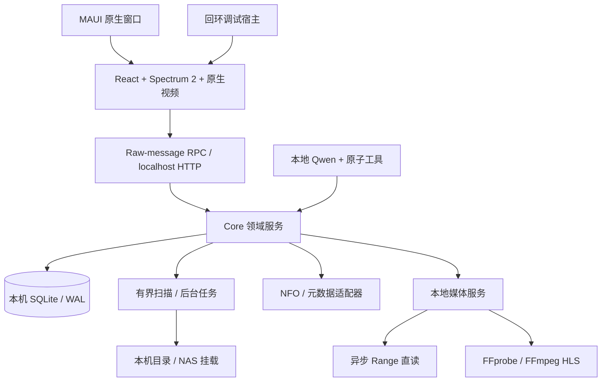

# 架构与参考依据

## 2026-11-11 扩展范围与实施记录

本节记录用户本轮授权的完整范围，不能把设计描述当成已交付功能。云盘与云下载明确排除。统计看板只调研，不在未决定统计口径前实现。

| 工作项 | 边界 | 当前状态 |
| --- | --- | --- |
| 网络与断网恢复 | 宿主基础模块统一 HTTP/浏览器路线，保留站点边界；只自动恢复连接故障 | 已实现；系统路线实连通过，离线→恢复任务流程在临时库验收 |
| 作品、版本、分卷、资源集 | 作品身份与真实文件身份分离；播放、探测、时钟和授权由宿主控制 | 已部署到 Windows；通过管理窗口、连续分卷、循环、导出锁定和资料库升级验收 |
| 文件移动身份 | 唯一文件系统身份识别改名；跨磁盘以 SHA-256 预览并再次验证后关联 | 已实现及回归；无预先指纹且原文件不可访问时拒绝猜测 |
| 通用资料流水线 | film / term 统一输入、提取、候选、独立证据组与一致性结算 | 已实现及回归，冲突与不足证据不自动覆盖 |
| 人物及厂牌资料 | 默认 term 定义及 Wikidata 映射；需要核对实体 ID | 已实现，实体接口已实连；使用共享值实体资料页、候选和证据流程 |
| 订阅与发现 | 来源声明定时快照、稳定外部身份去重、任务与候选审阅 | 已实现及回归；默认最多 100 项，不是完整历史爬取 |
| 外部播放器 | 固定能力登记、文件授权、生命周期 | Windows 实测 mpv 指定分卷续播及进度回传；其余仅启动及定位 |
| 在线字幕 | OpenSubtitles 搜索、显式下载、资源集绑定、系统安全存储 | 接口及回归已实现；尚无真实账户凭据验证 |
| 统计看板 | 下文提供口径、性能和隐私决策，暂不创建产品页面 | 调研完成，等待产品范围决定 |

### 已实现的数据边界

SQLite v4 的 `films` 只存作品身份与结构修订。`media_files` 保存物理路径、文件系统身份和探测事实；`media_versions` 与 `media_parts` 分别保存版本、顺序及独立续播位置。`resource_sets` / `resource_members` 管理作品、版本或分卷的任意附件。默认播放分卷由显式选择决定；版本、分卷均可排序。旧的物理字段已移除，UI DTO 的媒体字段来自只读投影，没有第二份可变文件清单。移除关联保留磁盘文件及标注历史。

标注主体继续是 film / term；版本和分卷是宿主媒体结构，不能借业务标签改写真实路径、时长或访问授权。时间标注和续播需要明确版本、分卷及媒体 revision，切换另一剪辑版本不能直接复用原时钟。作品标注、实体引用、候选和历史不随文件改名变化；身份歧义产生待处理记录，不能按同名、同大小或某个业务编号强行合并。

用户于 2026-11-11 明确授权本次唯一例外：允许先备份、可回滚的 SQLite v3 → v4 一次性迁移，保留现有资料。备份包含 WAL 已提交记录，升级在事务内完成；文件、标注、候选、任务和历史不得丢弃。其他旧格式仍明确拒绝，不新增遗留列或双份可变媒体模型。新结构先用临时库验证，不能为了通过测试重建用户资料馆。

### 通用资料与计算扩展的目标

公开资源定义目标主体、来源适用条件、请求参数、记录提取、身份核对、字段映射、独立证据组、缺失字段、置信策略和停止条件。宿主执行注册算子，不内置人物、厂牌、作品编号或来源站点分支。多个转载同一上游的站点不能算两份独立证据；冲突保留候选及证据，人工锁定、清空、拒绝记录和并发 revision 必须继续生效。

实体补全与订阅使用相同有效投影。订阅保存稳定目标、来源配置摘要、下次执行时间及任务 ID，冻结配置世代、实体修订和当前值；新条目先形成有来源的候选，经确认后按稳定外部身份建立或关联 term。默认发现每次读取最多 100 项快照，不提供历史分页游标，也不伪造本地影片文件。实体的标注变更、来源结果及候选事件可执行公共常量、事实复制与表达式规则；每次事件的全部写入以保存点和最终 DAG 校验共同提交或回滚。

### Peach 统计设计调研（代码证据，非运行验收）

参考提交 `ea0929615ce110b24e2e58654a37ec4bc27de8ad`，与 2026-11-11 查询到的 master 一致。已核对 `src/peach/web_stats.py`、`taste_history.py`、`web_activity.py` 及运维文档；没有运行用户浏览器历史采集，也没有复制业务实现。

**Peach 分成两类页面数据。** 库存/观看统计由账本 SQL 聚合；偏好分析还读取明确配置的浏览器历史、书签及导入记录，在独立分析库中形成快照。偏好页不是仅依赖应用内播放记录的普通统计，其数据来源和隐私边界必须单独决定。

| 模块 | Peach 的实际口径 | 在本项目需要先决定的事项 |
| --- | --- | --- |
| 库存、媒体类型、影片库 | COUNT/SUM，库存排除标记为 vanished 的记录；部分回收站记录仍计入 | 分开作品数、版本数、文件数、资源数；离线与已删除不能混为一类 |
| 画质、时长分布 | 使用固定分档和业务判据；按资产计数 | 分档应由声明表达；不同版本如何计数；未探测归未知而非零 |
| 资料覆盖率 | 编号、人物、厂牌、预览等固定字段的覆盖统计 | 改为定义声明的必需字段/目标范围，使用有效投影，不能写死业务字段 |
| 标签排行与来源 | 标签/来源聚合，包含具体来源白名单与人物名排除规则 | 通用分组查询、值实体身份、来源筛选、同义名及多值去重规则 |
| 观看与近期记录 | 累计播放时长、播放次数、进度、最近播放；本地与在线记录有去重条件 | 真实观看时长与 seek 距离分开，按播放会话记录，再决定作品/版本聚合 |
| 活动热力图 | 当前实现以每个作品的最后一次播放时间分桶，一部作品只占一格 | 不能宣称完整历史活动；需要真正的会话事件后才能统计每天观看时长/次数 |
| 重播分布 | 按每个资产的累计 play_count 分布 | 明确一次播放的阈值，以及暂停、重开、切换分卷的计次方式 |
| 磁盘与容量 | 每个根目录列状态，汇总按实际卷去重；无法读取容量返回未知 | 同盘多库、硬链接/重复路径、离线卷及附属资源的占用如何计量 |
| 偏好分析 | 7/30/90/365 天及全量窗口；浏览器历史、书签和本地行为组合 | 是否需要、显式数据源授权、撤销删除、保留期、来源可解释性；本轮不启用 |

**缓存与读取方式。** `q_stats` 把账本聚合和存储容量拆开。账本部分在同一只读连接内执行，按参与表的版本及影片库配置、时区缓存；目录是否在线和容量读取另走 TTL，避免每次页面刷新访问慢速挂载。偏好分析后台计算快照，键包含历史存储版本、分析清单、导入目录及时间窗；页面只读当前快照。上述思路值得采用，但不能把 Peach 的 SQL 字段、固定分类及来源名单搬入本项目。

**建议决策。** 优先考虑“资料库健康”看板：数量、占用、缺失文件、未探测、资料缺失、冲突候选、失败任务；这些指标直接服务管理操作。观看统计应等待作品/版本/分卷与播放事件模型落定；每个指标可打开相同范围的查询结果，并清楚标注单位、时间窗、未知项、去重口径及刷新时间。浏览器历史偏好分析单独作为可选议题，当前不实现。这里是建议，尚未取得用户对统计产品范围的决定。

证据：[账本统计](https://github.com/peach-mitao/peach/blob/ea0929615ce110b24e2e58654a37ec4bc27de8ad/src/peach/web_stats.py)、[偏好分析](https://github.com/peach-mitao/peach/blob/ea0929615ce110b24e2e58654a37ec4bc27de8ad/src/peach/taste_history.py)、[运维与存储](https://github.com/peach-mitao/peach/blob/ea0929615ce110b24e2e58654a37ec4bc27de8ad/docs/OPERATIONS.md)。

## 对照的 Peach 版本

2026-11-01 阅读 `peach-mitao/peach`，固定提交为 `462543c224164c110eb912bb772f1ab8a684597a`。参考的是行为、边界和数据流；应用以 C# 自行实现，没有将 Python/React 实现复制进工程。

| 阅读来源 | 采用的行为 | 本工程实现 |
| --- | --- | --- |
| [总体架构](https://github.com/peach-mitao/peach/blob/462543c224164c110eb912bb772f1ab8a684597a/docs/ARCHITECTURE.md) | 本地 SQLite 账本、模块化单体、离线时保留资料 | Core 服务 + MAUI HybridWebView + React 客户端；无外部数据库 |
| [扫描](https://github.com/peach-mitao/peach/blob/462543c224164c110eb912bb772f1ab8a684597a/src/peach/scan.py) | 路径身份、独立扫描任务、文件/元数据分离 | 有界 Channel、单库闸门、跳过符号链接、幂等入库；没有复制其检查点恢复系统 |
| [流媒体](https://github.com/peach-mitao/peach/blob/462543c224164c110eb912bb772f1ab8a684597a/src/peach/streaming.py) | Range 优先、断开连接停止流、会话回收 | 回环 TcpListener，1 MiB 异步读取块，随机能力 URL；FFmpeg HLS 限定两路 |
| [NFO](https://github.com/peach-mitao/peach/blob/462543c224164c110eb912bb772f1ab8a684597a/src/peach/library_nfo.py) | 同名 NFO、避免资料错配、身份核对 | 声明式 sidecar 来源及字段映射；XmlReader 禁用 DTD，4 MiB 上限；只读取同名文件 |
| [资料来源策略](https://github.com/peach-mitao/peach/blob/462543c224164c110eb912bb772f1ab8a684597a/docs/SOURCING.md) | 人工修改保留、明确来源、外部结果核验 | 通用字段锁定、来源记录、声明式身份匹配、访问间隔及缓存；图片失败保留文字结果 |
| [标签管理](https://github.com/peach-mitao/peach/blob/462543c224164c110eb912bb772f1ab8a684597a/src/peach/tag_management.py) | 稳定身份、别名、预览再执行 | 定义与值实体分离；有效值引用在事务内检测环路；去重按配置审阅后归档 |

原项目是 AGPL-3.0-or-later，名称和标志也有其自身政策。本工程使用 Vroom 名称、自有界面和图标。没有引入 Peach 的云下载、人物追更或多机账本同步模块。

## 工程边界

- `Vroom.Core`：不依赖 MAUI 的领域对象、SQLite、解析器、扫描、标签、去重、媒体、资料来源、模型与工具目录。
- `Vroom.Client`：React / TypeScript、Spectrum 2、多标签工作台、原生视频与 hls.js 播放及标注；不会执行原始 SQL、shell 或任意模型代码。
- `Vroom.App`：MAUI XAML 容器、平台启动、原生文件定位与 Windows 目录选择。
- `Vroom.Web`：仅回环监听的开发/诊断宿主，拒绝非本机 Host、远端连接和跨源请求。
- `Vroom.Tests`：纯领域和边界测试。
- `Vroom.Smoke`：真实 FFmpeg、媒体流、NFO、数据库、GGUF 推理集成检查。

## 领域与一致性

`Library` 持有多个绝对路径、排除片段和扫描策略。`Film` 表示一部作品；真实文件、版本与分卷分别由 `media_files`、`media_versions`、`media_parts` 表达（见上文“已实现的数据边界”）。

影片物理身份和媒体事实保存在中立的 SQL 列及 JSON payload 中，业务属性通过声明与标注投影读取。查询编译为参数化 SQL，不能把声明值当作真实文件路径或媒体时钟。所有同步 SQLite I/O 包装在后台任务中，用一个信号量串行执行；DAG 的检测和插入在同一数据库事务及同一写入闸门内完成。其吞吐限制及后续优化见当前审查文档。

声明 `parents` 表示配置层级，允许多个父节点，不允许环。可枚举值使用独立 Term 身份；影片和值实体都可有标注，值实体之间的有效引用形成另一个 DAG。声明本身不是可标注对象。别名只服务于名称识别，不会自动合并实体身份。

组合去重要求所有指定标签同时存在；每个选择的标签类型必须存在且完整集合相同。缺失的番号不会被归为“空番号重复”。一组候选必须至少保留一个，所有决定原子提交；归档的影片源文件不变。保留多项会赋予相同组 ID，并在下一次查重中排除已经复核的同组版本。

## I/O、媒体与模型

扫描生产者在后台枚举目录，用容量 128 的 Channel 向消费者交付视频，单库只允许一个扫描任务。影片登记与媒体探测分离：直接导入默认安排后台探测，旧有影片库遵循自身扫描设置；分类规则需要媒体事实时也会安排探测。数据库读取不依赖 NAS 在线，探测完成前影片已可浏览及尝试播放。取消令牌向目录循环、Channel、HTTP、媒体子进程和推理传播；系统级阻塞文件系统调用不可强制中断。

媒体服务只监听 `127.0.0.1` 随机端口。随机 256-bit token 在路径中，端点根据影片 ID 查表获得文件路径，没有任意文件路径参数。请求头限制 16 KiB，读取头超时 10 秒，最多 16 个连接；Range 正确处理后缀、开放末尾和越界。每次 HLS 转码只能访问其随机缓存子目录，使用 EVENT 清单保留已生成片段以支持暂停和回看；最多两路，心跳空闲三分钟自动回收。FFmpeg 使用 `ArgumentList`，禁用 shell，输入协议限制为文件/管道，进程取消时清理整个进程树。

模型权重只在首次推理加载，通过信号量串行化，CPU 最多使用 8 个线程，16384 token 上下文、2048 token 输出上限。JSON GBNF 限制输出语法，实际工具名称、参数、外键和领域不变量仍需验证。模型只能生成计划；变更属性来自应用的工具注册表，模型返回的所谓 approval 字段不会授权变更。

## 明确没有完成的部分

移动端 FFmpeg/llama.cpp 原生绑定，Apple 安全作用域书签与原生目录选择，大库查询与批量任务压力测试、跨进程文件系统游标检查点、结构化多来源候选冲突审阅，以及多机同步仍需后续实现。资料来源使用通用 sidecar/HTTP 传输和 XML/HTML/JSON/text 提取，HTTP 有按声明及 URL 区分的 TTL 缓存；真实外部站点适配和更完善的失败退避仍需验证。标签参数合同、查询语义、投影性能与服务边界的待办详见 [当前审查](CURRENT-CONTRACT-REVIEW.md)。

技术依据：[MAUI HybridWebView](https://learn.microsoft.com/dotnet/maui/user-interface/controls/hybridwebview?view=net-maui-10.0)、[React Spectrum Tabs](https://react-spectrum.adobe.com/Tabs)、[Spectrum style macro](https://react-spectrum.adobe.com/style-macro)、[hls.js](https://github.com/video-dev/hls.js)、[FFmpeg HLS muxer](https://ffmpeg.org/ffmpeg-formats.html#hls)、[LLamaSharp](https://github.com/SciSharp/LLamaSharp)、[Qwen 官方模型卡](https://huggingface.co/Qwen/Qwen2.5-0.5B-Instruct-GGUF)。

## 标签契约 v3（2026-11-02）

标签声明只描述字段；`vocabularies` 定义值集合，`term` 为可枚举值提供独立身份及修订。影片和值实体共享标注、历史、自动保存、查询及批量任务。全部有效实体引用形成跨字段 DAG，统一在事务中校验。配置分组不再伪装为布尔字段；不再接受字段声明作为标注对象，也不提供未发布版本的数据迁移。只支持当前格式，详见 [当前契约与架构审查](CURRENT-CONTRACT-REVIEW.md)。

## 四阶段操作动线（2026-11-03）

产品通过同一工作区提供导入、描述、自动分类、组合使用，不增加新手/专家模式。标签配置保持中立，案例名称、离散值和阈值只出现在测试中。

### 导入、事实与恢复

`library.import` 接受明确的文件或文件夹选择。文件不会扩展为父目录；文件夹保存为持续发现源。加入已有影片库时，立即扫描只覆盖本次选择，定时扫描才使用完整来源。文件导入可以创建无监视目录的影片库。影片登记后独立调度 `media.probe`、资料补全任务，扫描不等待媒体读取。公共媒体事实声明类型、单位和依赖；`probe.state` 区分未知、读取中、就绪及失败，缺失测量值返回 null。文件变化使旧媒体事实失效。

`film.availability` 在后台检查实际来源，播放器据此提供定位和重试；探测失败不等于不能播放。所有 RPC 可携带 `context:{tabId,title}`，持久任务及子任务保存来源。任务结果提供返回来源、打开影片库/影片或定位输出等动作，失败任务沿用已有重试和调度能力。启动先比较公共 `clientApiVersion` 和宿主 bootstrap，再读取语言与工作区；配套失败提供重载/重试。

### 一套查询与选择范围

`query.ts` / `QueryBuilder` 直接编辑现有 Query AST，包含类型匹配比较、全部/任一/排除、关联选项属性、时间点/区间范围、排序及分组。影片列表与智能列表共用它，不保存第二份查询格式。字段信息入口生成同样的 AST；选项资料可回到相关影片。影片标注自动保存，配置草稿自动保留，应用配置才改变有效声明；影响预览仅比较本次新失效和有效值变化。

`films.ids` 返回完整、稳定排序的结果快照，忽略仅用于界面分页的 offset/limit。临时播放队列保存这份 ID 顺序，智能列表保存动态查询。多选栏区分当前已选与全部筛选结果，批量标注、规则重算、压缩共用冻结范围。批量操作限制明确报错，不截断；转换将大范围分为可追踪的预览批次。工作区以 UTF-8 18 MB 为保存上限，覆盖 10 万 ID 队列，超限不替换原状态；传输上限为 20 MB。

### 条件分类与一致性

公共能力注册表登记 `value.match@1` 的事件、参数及写入策略。每字段一张有序条件表；表内分支使用现有表达式 AST，首个匹配生效，无匹配不写入。数值范围向导生成明确的半开区间并将界面单位换算成事实单位。复杂规则继续支持组合条件和声明内的其他已注册执行器。

自动执行与 `automation.preview` 共用依赖检查、严格比较、未知值和匹配评估器，未知不能因否定而被当作命中。导入规则缺少媒体事实时等待，`media.probed` 后重试。`automation.prepare` 为现有影片安排持久探测任务。试算返回事实、命中分支、前后值、重叠及等待/保护/无匹配原因；未发布草稿和临时输入不产生提交令牌。

已发布规则的真实影片预览冻结 ID、配置世代、媒体版本/相关事实、标注及依赖版本。`automation.commit` 以预览令牌创建可暂停恢复的任务，逐项检查并发冲突，不在执行中重跑可变查询。规则身份和规则内容哈希分离，修改阈值仍可识别原规则写入；手动值、锁定、清除及被抑制成员受到保护。规则及声明变更仍走已有事务、有效投影和 DAG 校验。

### 组合操作与预览边界

转换页默认呈现源影片、方案、输出位置、开始；方案参数来自公共转换资源，完整编码能力收在高级设置。试压生成独立短片，结果以实际大小和输出位置展示，不承诺压缩比例。输出仍使用原有冻结来源/目标、冲突检查和独立文件策略。

布局预览与实际表面共用 `LayoutFrame` 及区域配置，使用真实 TagInput/TagValue 和本地预览状态；不执行写入、播放、素材网络读取或宿主命令。右侧紧凑位置图仍是示意，展开视图才呈现配置布局。公共 Schema、能力表、Monaco、Agent 工具与知识同步。功能测试证明契约和执行结果；自主学习与视觉质量须另做真实用户及界面验收，见 [验证记录](VALIDATION.md)。

## 原生播放（2026-11-05）

Windows 播放页默认使用 mpv 0.42.0，每个播放 tab 有独立解码进程、随机命名管道和命令队列。界面继续共用队列、标注 Surface、进度保存、截图及自定义菜单；浏览器宿主默认保留 HTML5/HLS。安装运行包用 scripts/setup-mpv.ps1，setup-runtime 与 Windows 发布脚本已包含 mpv；设置中的 mpv 路径必须是现存的绝对路径。

能力、默认值和 native.* 请求合同集中在 resources/tagging/host-capabilities.json，经 native-playback.schema.json、native-playback-command.schema.json 暴露。宿主只接受影片 ID 与受限控制参数，不提供任意 mpv 命令、文件路径、脚本或窗口句柄入口。设置先验证整组参数，失败时回滚已改属性。字幕上传受格式和大小约束，临时字幕和截图只写入会话目录。

Windows 已改为 GPU 合成：`WindowsCompositionHost` 用 `CoreWebView2CompositionController` 和 Windows Composition 的 topmost desktop target，将带 alpha 的 WebView 视觉树合成在解码子窗口上方。mpv 仍在独立进程中输出到有独立消息循环的 HWND；禁用视频子窗口的输入，由上方 WebView 处理鼠标和键盘。没有 CPU 逐帧回读，也不再使用 GDI 区域给弹层挖洞。菜单、阴影和半透明界面由系统合成器混合；`native.surface` 版本 8 仅报告播放区域的位置、尺寸、缩放和可见性，拒绝旧 occlusions 参数。普通 WinUI WebView2 控件的透明背景限制不能代替这个 composition-controller 实现。

### 独立对话窗口（2026-11-08）

Windows 的共享 `Modal` 和 `Modal.confirm` 统一创建真正的 owned AppWindow，每个窗口包含同一 WebView2 environment/profile 下的 controller。`NewWindowRequested.NewWindow` 保留同源 opener，React portal 将内容渲染到子文档，状态、回调和服务仍属于原标签页，不重建工作区或播放器。只接受打包的 `dialog.html` 和受限尺寸/模式参数；外部网址及未知窗口参数不能进入此入口。此结构不是独立 JavaScript 进程隔离。

- `mode="exclusive"`：确认、导入审核和草稿编辑。先建立 owner 再启用 `OverlappedPresenter.IsModal`，操作系统阻止父窗口输入，后台播放/任务继续。嵌套编辑器以当前对话窗口为 owner，逐层恢复输入。
- `mode="modeless"`：播放设置、截图、快捷键、任务详情、布局预览和不兼容标注详情。父窗口仍可操作；窗口可移动、调整大小，并随 owner 关闭。两类窗口的标题均只显示功能名称，不标注独占模式。
- 系统关闭按钮先请求 React 执行现有取消逻辑；正在提交的确认窗口可暂缓关闭。内容卸载才关闭原生窗口。父文档重载、渲染器故障和宿主退出回收子窗口，并释放独占状态；未完成初始化的窗口超时回收。
- 原生对话窗口持续跟随内容高度：客户端在**弹窗自身的 Window realm** 创建 ResizeObserver，观察正文、操作栏及容器尺寸，测量自然高度并合并发送；不能用 opener 的构造器，否则主文档不绘制时子窗口尺寸通知会停滞。宿主按窗口当前显示器的可用工作区、DPI 和 WebView 缩放限制高度，包含系统标题栏。内容减少时窗口同步缩短，达到屏幕高度后正文才滚动，操作栏保持可见；稳定滚动条槽位避免换行与尺寸反复变化。保留用户调整的宽度及位置，仅在越过工作区边缘时移动；最大化/最小化期间不自动改尺寸，恢复后重新适配。嵌套 Spectrum popover、右键菜单、焦点及诊断监听使用各自的文档；语言变化原位更新标题和内容，草稿不重建。网页宿主与当前 Mac Catalyst 仍使用页内对话框，尚不具备原生独占/非独占窗口交付能力。

- 自动适配窗口时，正文默认隐藏纵向滚动条。宿主通过 `dialog-size-limit` 消息报告当前显示器/DPI/WebView 缩放下可容纳的最大客户区高度；最大化时改用实际客户区高度。只有自然内容超过此容量才允许纵向滚动，不把异步调整过程中尚未长高的临时 viewport 当成高度上限，也不使用定时隐藏/延迟显示。容量更新即使没有内容高度变化也会重算；已超限的内容再次变化时保留滚动条。继续使用 [`scrollbar-gutter: stable`](https://developer.mozilla.org/en-US/docs/Web/CSS/Reference/Properties/scrollbar-gutter) 保留隐藏/可滚动状态间的相同正文宽度，避免换行反馈。
- 浮层以所在文档的 viewport、边界元素和 DOM 构造器计算位置。`build/react-aria-owner-window.mjs` 修正当前 React Aria 的模块级主窗口引用，沿用其翻转、边距限制、最大高度、滚动与焦点锚点算法；选择框、搜索选择器和菜单共用这一边界行为。弹窗大小改变时重新定位，浮层滚动不关闭列表。Esc 先交给当前浮层处理，同一次按键不能同时取消外层草稿。适配同时用于开发服务和生产构建，依赖源码/模块变化时必须重新核对，不能静默跳过。

依据：[WebView2 NewWindowRequested](https://learn.microsoft.com/en-us/microsoft-edge/webview2/reference/winrt/microsoft_web_webview2_core/corewebview2newwindowrequestedeventargs)、[Windows modal ownership](https://learn.microsoft.com/en-us/windows/windows-app-sdk/api/winrt/microsoft.ui.windowing.overlappedpresenter.ismodal)。

状态读取和窗口更新独立于解码命令队列。停止先取消 IPC、终止进程，再完成回收，避免等待卡住的命令；Windows Job 的 kill-on-close 使宿主意外退出时回收解码子进程。失效会话的窗口更新幂等返回，前端在错误或退出后停止更新。日志包含 tab 来源，仍使用有轮转与脱敏的本地诊断文件。解码进程隔离不等于所有 WebView/JavaScript tab 已具有独立进程。

对标来源只作为行为与能力参考，没有复制这些播放器的源码或素材：

| 开源项目 | 本次采用的能力方向 |
| --- | --- |
| [mpv](https://github.com/mpv-player/mpv) | 实际播放内核、轨道/章节、精确定位、逐帧、音画同步、渲染参数和 JSON IPC |
| [mpv.net](https://github.com/mpvnet-player/mpv.net) | Windows 原生播放器与快捷操作的组织方式 |
| [MPC-HC](https://github.com/clsid2/mpc-hc) | 音轨/字幕、播放导航、图像比例和设备选择 |
| [IINA](https://github.com/iina/iina) | 播放页内的分组定制、字幕及图像控制 |
| [VLC](https://github.com/videolan/vlc) | 声道、输出设备、同步及播放诊断 |

mpv 参数语义依据[官方手册](https://mpv.io/manual/stable/)；本次集成验证的是受控参数子集，不声称覆盖上述播放器全部功能。

### macOS 与 Windows 播放体验一致性（2026-11-05 决策）

目标是两端使用同一播放页、菜单、设置、队列和标注流程，并保持页内视频、鼠标/键盘操作、全屏、界面叠层及故障恢复的一致体验。平台快捷键可遵循系统惯例。独立 mpv 窗口不满足此目标。若实现难度、维护成本或性能代价明显上升，需要及时向用户说明具体原因和可选取舍，再决定后续投入；不能静默缩减为“可以打开视频”。

Windows 已使用独立 mpv HWND 加 WebView GPU 合成；Mac Catalyst 的 `NativeVideoSurface` 返回 `Embedded=false`，自动模式选择浏览器播放，显式 mpv 模式走独立窗口。Windows Composition/AppWindow 不能直接复用于 Mac；Mac 的视频合成、WKWebView 子窗口和原生独占关系仍需平台宿主实现及 Apple Silicon 实机验证。非 Windows 的 Unix socket 代码不等于 macOS 页内播放已完成。`DecoderLifetime` 的宿主退出回收目前仅实现 Windows Job；前端 tab 仍共享 WebView 进程。这些差距均须计入一致性验收。

成本判断来自当前代码边界和上游接口，尚不是 Mac 原型的性能结论：

| 路线 | 代价与限制 | 当前判断 |
| --- | --- | --- |
| 独立 mpv 窗口与 JSON IPC | 改动较少，但视频离开播放页，叠层、焦点及全屏流程不同 | 不作为一致体验交付 |
| 独立 mpv 子窗口与系统 GPU 合成 | 保留解码进程边界，界面 alpha 由系统合成；原生窗口层需分别实现 | Windows 已实现，Mac 尚未验证可用宿主组合 |
| 主进程内 libmpv 渲染 | 能控制画面合成，但原生解码崩溃可能影响整个宿主 | 可用于验证渲染，不能据此宣称崩溃隔离完成 |
| 独立解码进程与共享 GPU 画面 | 需平台图形互操作、帧同步、进程回收、异常重建及打包；成本高 | 当平台原生窗口合成不能满足需求时的候选，尚未实现 |
| 直接更换整个 UI 框架 | 会扩大现有界面、输入、部署与回归范围，且不会自动提供解码隔离 | 渲染验证前不做整体迁移 |

[mpv 官方示例](https://github.com/mpv-player/mpv-examples/blob/master/libmpv/README.md#methods-of-embedding-the-video-window) 明确区分原生窗口嵌入和 render API，并说明窗口嵌入的平台差异及渲染 API 对合成的优势。[IINA 的 MPVController](https://github.com/iina/iina/blob/develop/iina/MPVController.swift) 使用 libmpv 的 OpenGL 渲染上下文；这是 macOS 播放集成的参考，不是本项目已具备 Mac Catalyst 和跨进程渲染的证明。不能由 mpv 支持 macOS/Metal 推断所选版本的公开 render API 提供可直接嵌入的 Metal 后端。

现有 Mac Catalyst 宿主先保留。是否需要薄 AppKit 宿主或原生辅助模块，必须由实际图形与 WebView 合成验证决定；业务服务和 React 界面应保持共享。[MAUI AppKit 后端](https://learn.microsoft.com/en-us/dotnet/maui/developer-tools/platform-backends/macos?view=net-maui-10.0) 当前标为实验性、非 Microsoft 正式支持，不能当作无成本替换方案。

Mac 实机原型的继续条件：

1. 在实际播放页内渲染，菜单、弹框和工具提示覆盖时持续有画面；透明度与遮罩行为明确验证，不能仅检查播放时钟或截图接口。
2. 真实鼠标单击、双击、右键、滚轮与键盘操作生效；验证全屏进出、窗口缩放、Retina/外接显示器切换及输入焦点。
3. 同时运行两个播放会话，分别终止和挂起一个解码器；另一个和主界面继续响应，失败会话可重试；宿主退出后没有遗留解码进程。
4. 使用有代表性的 1080p/4K 媒体，记录实际硬件解码路径、掉帧、CPU/GPU 占用和内存；与同一机器直接运行 mpv 对照，不能用持续 CPU 回读/复制帧掩盖性能差距。HDR 输出单独验收。
5. 切换语言、修改配置和切换 tab 保持播放会话与草稿；运行包能在干净环境启动，不依赖开发机的 Homebrew 动态库路径，并验证签名、公证与依赖许可。

若原型依赖私有系统 API、需要重写主界面、只有明显性能退化的方案，或只能取消故障隔离，则停止扩大该路线并提交具体测量结果和替代方案。用户已确认有 Apple Silicon Mac，并选择在 Mac 本地运行验证脚本；本会话仍在 Windows，尚无 macOS 构建、运行、性能或签名验证结果。不承诺交付日期或将此设计记为已实现功能。

首轮入口为 `scripts/verify-macos.mjs`，步骤与反馈文件见 README。Mac Catalyst 补齐当前 MAUI 场景生命周期声明；Unix IPC 使用 `/tmp` 下随机私有目录，避免 macOS 长 `TMPDIR` 超出 Unix socket 的路径上限。真实解码测试在非 Windows 环境校验 socket 路径长度、权限及会话清理。上述改动是实机验证的准备，不构成渲染层原型或完整的跨平台隔离。
