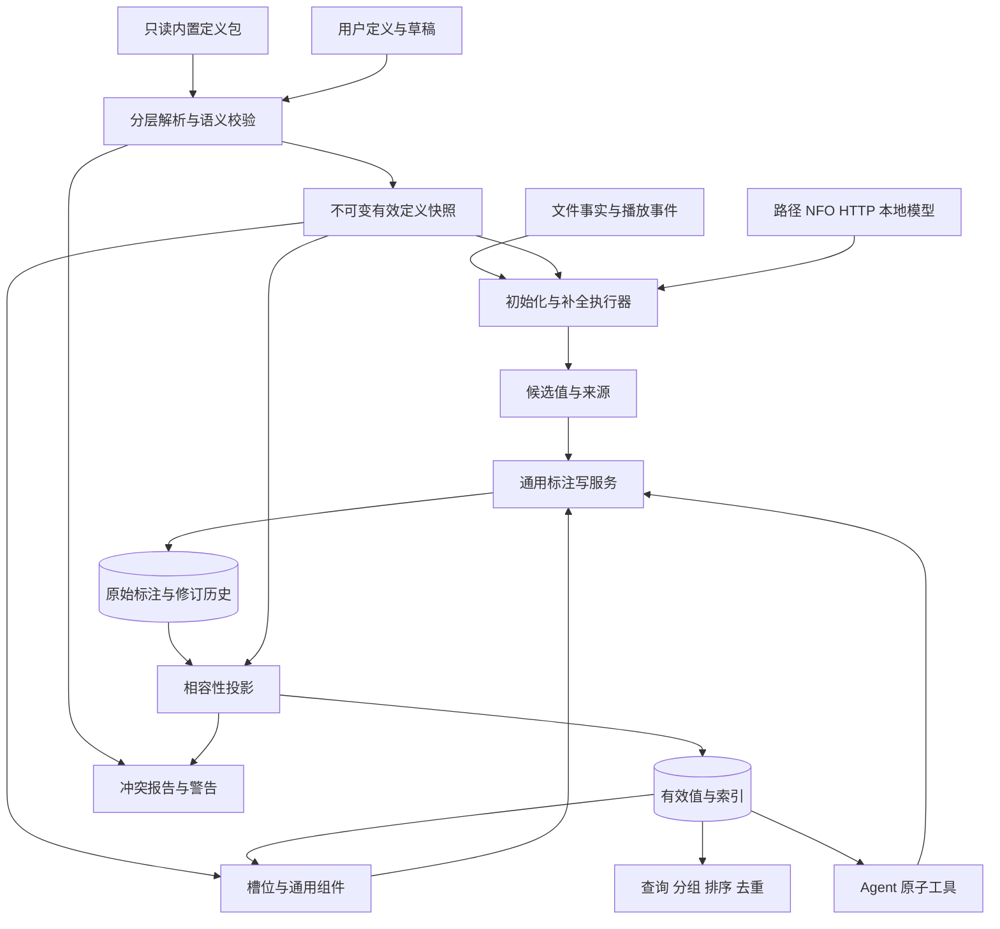
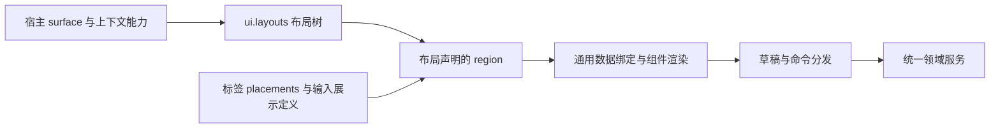

> 历史设计记录：当前实现仅支持 v3 契约，不再包含旧数据兼容或迁移。以 [当前架构审查](CURRENT-CONTRACT-REVIEW.md) 和 `resources/tagging/` 为准。

# 标签系统配置化重构技术设计

日期：2026-11-01。设计修订：0.3。状态：原 v1 设计档案，当前已升级至 v2 值实体模型；当前公开资源和 v2 实施记录优先。适用工程：Vroom.Core、React Spectrum 客户端、MAUI 与本地 Web 宿主。

> 2026-11-02 语义复审：第 4.2、4.3 节将具体可枚举值编码成标签声明，导致字段与选项身份混淆，不能完整满足“给具体标签值加标签”的需求。后续设计以 [可枚举值模型复审](TAG-VALUE-MODEL-REVIEW.md) 为准：声明描述规则，具体值实体接受标注。该修正已实施，见 [v2 实施与迁移记录](TAG-VALUE-MIGRATION-V2.md)。普通标注主体为 `film` / `term`，声明 DAG 与值关系 DAG 分开验证。

本次重构将影片的业务属性统一为可配置标签。标签声明描述值的约束、标签 DAG、输入与展示组件、界面槽位、分类入口、初始化和资料补全策略；标注记录保存具体对象的值、时间位置与来源。客户端根据声明生成界面，查询、去重、自动化与 Agent 使用同一份有效标签模型。

核心方案是 **版本化标签声明 + 有来源的原始标注 + 按声明生成的有效数据投影 + 通用 UI 槽位**。内置声明与用户声明分层管理，同 key 的用户声明完整覆盖内置声明。声明变更不删除历史标注，所有业务读路径只使用与当前声明相容的部分。

阅读入口：[耦合审计](TAG-SYSTEM-COUPLING-AUDIT.md)、[定义与覆盖](#5-定义文件协议与覆盖规则)、[统一-i18n](#63-统一-i18n-契约)、[动态页面设计](#8-通用槽位与界面生成)、[事件与规则](#9-初始化与资料补全)、[导入导出](#12-导入导出协议)、[迁移](#15-旧数据迁移)、[验收](#17-验收标准)。

## v1 实施记录

权威运行契约为 [`resources/tagging/`](../resources/tagging/) 中的 JSON Schema、默认声明、宿主能力和 Agent 知识；设计示例不能替代实际资源。`AGENTS.md` 将产品中立、有效交集、系统/用户隔离、公共资源、Agent 审核和测试列为强约束。

- Core 的 `Tagging/` 实现声明编译、分层覆盖、DAG/类型/引用校验、世代 CAS、事务发布、有效投影、标注历史、失效诊断、导入导出、规则/补全/事件与冻结批量任务。旧业务类型、解析器和 DSL 隔离到 `Tagging/Migrations/`，旧物理列只用于存储兼容。
- React 的 `tagging/` 统一组件输入/显示、ICU 文案、动态表单、卡片/导航槽位、影片详情与播放侧栏。标注行的标签、值、时间、备注和动作通过 `annotation.row` 描述。新增合法字段不需修改页面代码。
- 所有内置声明包含中英文描述，用户描述可省略。弱化信息提示分行显示描述、数据来源和锁定状态。Tag Select 支持单/多选、搜索、创建和移除，已选集合与下拉集合隔离。控件高度来自 Spectrum token，表单按容器适配，layout.span 可覆盖默认宽度。
- 2026-11-02：字段说明和操作合并为单一信息按钮，悬停看说明、点击打开清空/解锁等操作。默认资料页与标注侧栏使用 `commitMode: auto`，450 ms 合并连续输入、每个影片/标签页串行写入；上方通过声明的 `form.undo` / `form.redo` 动作提供最近 30 个已保存事务的撤销重做。工作区保留待写请求和历史，重试使用同一幂等键，撤销也执行世代与字段修订校验。显式配置的 `on-submit` 表单仍保留提交边界。
- Monaco 按公开 JSON Schema 补全、默认格式化，发布前展示受影响标注。系统对象只读，用户覆盖完整替换。发布后镜像保存到用户配置版本目录，数据库事务决定生效；不监视磁盘文件的任意外部修改。
- 定义、标注和合并包分别支持预览/发布。当前值导出只含有效交集，归档保留原始历史。首次迁移前备份 SQLite，兼容迁移已存视图与工作区。
- Agent 读取同一公开 schema 和有效快照；声明写入仅限用户层，批量操作冻结 ID/revision，持久任务支持暂停/停止/重试。冲突不覆盖，模型不能用输出参数授权自身。

### 当前边界

宿主能力以 `host-capabilities.json` 的 implemented/reserved 状态为准。只能组合已注册节点、组件、表达式与动作，配置不执行任意代码。下文保留的目标设计包含扩展项，不能据此声称全部已经交付。

配置变更在串行 SQLite 事务中重建投影，尚未实现大库分阶段后台换代；批量任务有持久检查点。初始化提供正则/字典/事实映射，不包含通用日语人名识别模型。资料源支持本地 XML/NFO 和受限 HTTP HTML/JSON/text，默认同名 NFO；逐站点重试/冷却和真实成人站点验收尚未完整实现。多值分组按完整数组统计，不展开所有组合；多个身份 profile 当前使用配置顺序中的首项。

Schema 作者文案支持共享 i18n；部分中立宿主旧任务/错误句子尚未改为可重新翻译的 messageRef。任意表达式的全面静态类型推导、完整候选/表格模板和预留事件属于扩展范围。Mac、移动端及大库/NAS 长时间压力验收尚未完成。实际检查见 [验证记录](VALIDATION.md)。

## 1 目标与设计边界

### 1.1 必须达成的行为

| 需求 | 设计落点 |
| --- | --- |
| 一切皆为标签 | 标题、番号、演员、评价、收藏、观看状态、清晰度、时长、海报、来源等均通过标签值访问 |
| 一切皆可配置 | 标签文件决定类型、约束、组件参数、布局位置、导航、查询能力、初始化和补全规则 |
| 两类配置可分开或合并交换 | 标签定义包、标注数据包；合并包只是两者的容器，不引入第三种业务模型 |
| 用户覆盖系统 | 用户层按稳定 key 完整覆盖系统层；更新系统包不改写用户层 |
| 只读声明与数据的交集 | 显示、筛选、计数、排序、分组、去重、导出当前值和 Agent 全部经过有效数据投影 |
| 每个标签有 JSON 编辑器 | Monaco、默认格式化、Schema 提示、DAG 与业务诊断、效果预览、影响预览 |
| 原有能力继续可用 | 标签给标签分类、点和区间标注、智能列表、临时播放列表、多 tab 保活、后台任务、NAS 异步处理 |

### 1.2 软件保持中立的具体含义

业务运行时不得根据 `core.rating`、`core.favorite`、`core.cast` 等特定 key 或中文标签名分支。软件只认识通用的值类型、组件类型、布局槽位、文件事实能力、表达式操作符和受控执行器。例如，`rating` 是可复用的输入组件类型，任何数值标签都可以选它；“评价”是内置配置赋予某个标签的含义。

“可配置”以这些能力的契约为边界：配置可以选择和组合已注册组件与执行器，不能包含任意 JavaScript、C#、SQL、shell、React 代码或任意 CSS。增加一种全新的组件或解析算法需要实现一次通用能力，再由配置调用。所有颜色、间距、密度和图标使用现有 Spectrum token 与图标注册表。

文件 ID、真实文件定位、访问能力令牌、存储事务、任务状态、媒体会话等仍是基础设施。它们的**可展示属性可以映射为标签**，但修改“路径标签”不等于移动源文件，修改“清晰度标签”不等于改变视频编码。播放服务继续读取真实媒体资源与探测事实，不能依赖一个用户可隐藏、改名或覆盖的标签决定解码参数。这是保持数据真实与标签自由配置同时成立的必要边界。

本设计明确采用以下默认值，它们属于内置声明或迁移策略，均不写死在通用引擎中：

- 新影片没有识别到评价时为“未评分”，不自动归入“一般”；有效评分为整数 1–10。
- 旧版五档评价映射到 2、4、6、8、10，保留原档位；这不代表恢复了过去不存在的十分制精度。
- 左栏第 n 颗星打开对应的精确档位，点击第四档筛选 7–8 分，不表示“7 分及以上”。
- 新影片收藏为 false、未看过为 true；播放完成事件可以将未看过设为 false，规则写在声明中。
- 失效标注默认保留原文并停用；没有用户明确发起的数据迁移，不自动截断、缩放、转型或删除它们。

## 2 改造前实现与设计范围（历史依据）

改造前存在两套互相同步的业务属性：`Film` 的固定字段，以及 `tags / film_tags` 中的标签。重构需要消除两套业务数据的长期并存，不能只在现有页面外包一层动态表单。

| 位置 | 当前实现 | 目标 |
| --- | --- | --- |
| `Core/Domain/Models.cs` | `FilmRating`、`TagKind` 枚举，Film 固定包含 Rating/Favorite/Watched 等 | 媒体实体保留技术身份；标签声明与标注承载业务属性 |
| `Core/Storage/CatalogDatabase.cs` | films 固定投影列、JSON payload、film_tags、tag_edges、独立 annotations | 版本化声明、原始标注历史、有效投影与通用索引 |
| `Core/Storage/CatalogRepository.cs` | 番号和评价有特殊增删、同步及命名限制 | 统一类型校验、写入策略、引用校验和事务 |
| `Core/Query/FilterCompiler.cs` | rating、favorite、watched 等固定字段白名单 | 以 tag key 为字段的有类型查询 AST |
| `Core/Library/PathTagParser.cs` | 返回固定 Code、Rating、Performer 等 | 执行配置中的路径规则，输出通用候选值 |
| `Core/Library/LibraryScanner.cs` | 扫描时直接写 Code、Rating；探测写 Width/Height | 扫描产生文件事实与事件，规则生成标签标注 |
| `Core/Metadata/MetadataService.cs` | 固定 NFO/JavBus 适配器、固定 Metadata DTO | 可配置资料源、字段提取和标签映射 |
| `Core/Library/DuplicateService.cs` | 使用 TagKind/TagIds，固定按高度和大小推荐保留项 | 去重键与推荐排序都引用标签声明 |
| `Client/src/types.ts` | Film 固定属性、ratingNames/kindNames | Schema 派生的通用 DTO 与能力清单 |
| `FilmPage / PlayerPage / FilmCard / LibraryPage / App` | 固定评价、收藏、已看、分辨率及导航 UI | 同一 SlotRenderer 与 TagValueRenderer |
| `Core/Application/ClientApi.cs` | film.position 直接更新 Watched；bootstrap 返回全部标签 | 播放事件与标签规则分离；声明快照与选项分页 |
| `Core/Intelligence/AgentTools.cs` | film.update/tag.create 参数认识评分和标签类型 | 原子、通用、按当前声明发现参数的工具 |

以上路径省略共同前缀 `src/Vroom.`。现有代码是迁移依据；本文件后续的组件、表和接口名称均为拟新增或拟替换的设计。

第二轮审计补充发现：Agent 的系统提示词仍固定评分 0–4，导航图标按 favorites/unwatched ID 选择，截图命名优先使用番号，默认浏览隐式排除 archived，SQL 将中文“未分类”作为分组键，旧 tab 恢复按中文标题替换。这些也必须迁移。逐项证据、schema 去向、技术约束保留边界与验收方式见 [业务耦合审计清单](TAG-SYSTEM-COUPLING-AUDIT.md)，不能只改页面标签名。

## 3 总体架构



Core 对外发布 `DefinitionSnapshot`：有效声明、DAG、组件描述、槽位编排、可查询字段、规则计划、诊断及 `generationId`。客户端不能自行合并两层定义，也不各自解释“有效数据”的规则。

声明编译与标注投影完成后整体激活一个新 generation。正在阅读的页面始终看到某个完整版本，不出现新 UI 配旧索引。大批重建、导入、导出、探测、联网补全和迁移全部进入现有持久后台任务中心。

## 4 核心模型与身份

### 4.1 标签声明

`TagDefinition` 是标签的稳定声明，包含 `key`、显示名称、父标签、值约束、适用对象、编辑与展示方式等。key 不依赖名称、路径或数组位置，例如 `core.rating`、`core.cast`、`user.person.01jabc`。

key 使用大小写敏感的 ASCII 命名空间和标识符，初版限定 `[a-z][a-z0-9]*(\.[a-z0-9_-]+)+`，长度不超过 160；用户创建时生成稳定 ID，别名和显示名称另存。修改名称不影响引用，修改 key 必须执行显式身份迁移。`core` 命名空间可以被用户同 key 覆盖，但导入文件自称“系统定义”不会得到系统层写入权限。

### 4.2 标签值与标签声明不是同一对象

评价声明只有一个，影片上的 7 分是它的值，不生成一个“7 分标签声明”。普通标签可以是布尔值；演员等需要共享身份、别名和关联关系的可枚举对象，也是独立标签声明，由选择器通过 `tagRef` 引用。

例如 `core.cast` 是可新增多选字段，它的选项来自声明 DAG 中演员集合下的节点。某演员节点可以同时属于“演员”和“喜爱的演员”等分类，并且自己使用布尔输入组件，允许直接标记影片。展示时同一引用只展示一次，不能同时把 `core.cast` 的值和对应演员节点渲染成重复标签。

不需要独立身份的固定枚举也可直接声明为稳定的 `optionId + label`。改 label 不改 optionId；禁止用翻译后的中文名作为外键。

### 4.3 声明 DAG 与给标签打标签

声明通过 `parents: [tagKey, ...]` 建立边：**父标签 → 子标签**。多父节点合法，自环和任何有向环非法。

- 给“演员 A”打上“喜爱的演员”分类，等价于给演员 A 的声明增加父节点；属于**标签定义**变更。
- 给影片选择演员 A，属于**标注数据**；数据保存 `core.cast → tagRef(演员 A)`。
- 给演员 A 填写生日、备注、评分等值，属于作用于 `subject.kind = tag` 的**标注数据**，不自动生成分类边。
- `tagRef` 是值引用，不等于父子关系；计算规则的依赖图也单独校验，不能把 UI 顺序、值引用、分类 DAG 混成一个图。

父子关系默认只表达分类可达性。不会自动继承组件、值约束、补全策略或权限，因此多父节点不会产生隐含的继承优先级。需要复用的声明片段使用带版本的模板，在编译时展开；最终有效声明必须完整且可独立查看。

创建选项时如果需要新增演员节点，先验证候选定义图，再在同一次发布操作中提交新定义和引用标注，不能先写一个尚不存在的 tagRef。对内置演员分类或演员节点的分类修改也写用户层，不修改内置文件。

校验必须针对**覆盖合并后的完整图**。一个文件内部无环，不代表它和当前系统定义组合后无环。错误报告包含形成环的 key 路径与 JSON Pointer；有环的定义不能激活，保留上一份可用快照。

### 4.4 标注与作用范围

一条 `AnnotationRecord` 包含：

| 字段 | 含义 |
| --- | --- |
| id / revision | 标注稳定 ID 与修订号，修订历史不可变 |
| subject | `film` 的媒体 ID，或 `tag` 的标签 key |
| scope | 整体、点或区间；点和区间带稳定 scopeId |
| tagKey | 值对应的标签声明 |
| operation | `set` 或 `clear`；clear 表示明确清空，不等于没有导入过 |
| value | 规范化 JSON 值；多选保存集合数组 |
| note | 可选备注，不影响值的类型 |
| definitionHash / valueContractHash | 写入时的完整声明与值契约身份 |
| origin | manual/path/probe/metadata/event/import/model/migration 等通用来源，及具体规则、文件版本、来源 URI |
| provenance | 观察时间、候选置信度、规则版本、导入批次和原始值摘要 |
| editPolicy | 当前值的人工锁定与自动覆盖限制 |

同一 subject、scope、tagKey 只有一个当前赋值头；多选在该头中保存集合。每个不同的点或区间可以有自己的 scopeId，允许同一时刻存在多组不同备注。批量修改使用明确的 `set/add/remove/clear` 操作，避免全量覆盖别人新增的多选值。

影片 ID 仍代表一个实际媒体文件，多个版本不因番号相同而合并身份。DAG 中的演员节点也不因同名自动合并。

时间使用整数微秒的十进制字符串 `startUs/endUs`，避免跨 C#/JavaScript 的整数精度和浮点比较差异；区间为左闭右开 `[startUs,endUs)`，点不伪装成零长度区间。需要逐帧身份时额外保存 `pts + timeBase + streamIndex + mediaRevision`，不以平均帧率倒算 VFR 帧号。影片内容替换后重新核验时间标注，不把旧帧标注无条件绑定到新内容。

### 4.5 原始值与有效值

业务 API 返回的 `ResolvedTagValue` 包含值、显示文本、来源摘要、是否可写、当前 revision 和状态。状态至少区分 `valid`、`unset`、`pending`、`invalid`；缺值不等于 false、0 或默认值。

默认值是初始化时产生的、有来源的真实写入，不是每次读取时临时填上。这样声明中的默认值变化不会悄悄修改已有影片，旧无效评分也不会因新默认值而重新出现。

原始数据专用诊断与备份接口可以读取失效值；影片页面、搜索、排序、导航计数、去重、补全决策和 Agent 的日常查询不能读取它们。人工明确清空的值不能被“只补缺失”任务立即填回。

## 5 定义文件协议与覆盖规则

### 5.1 两类文件

| 文件 | 根 kind | 内容 |
| --- | --- | --- |
| `*.tagdefs.json` | `tag-definitions` | 标签声明、DAG、共用规则与资料源、模板、兼容要求 |
| `*.annotations.json` | `annotations` | 媒体身份描述、当前标注或完整历史、定义指纹、来源及清空记录 |

小数据可以将两者放进 `kind: tag-bundle` 的一个 JSON 文件。大数据使用 ZIP 容器放同样的两份 JSON 和校验清单，标注数组流式读取；附件可选单独打包。两种容器内部的业务结构一致，版本同为 `formatVersion: 1`，不把 ZIP 当第三种配置语义。

根文档包含格式版本、包 ID、包版本、最低引擎能力、声明语言版本和 schema 标识。包版本用于更新与兼容提示；内容 hash 用于判断内容相等。禁止仅比较版本号就信任外部包。

根文档还允许 `catalogPolicy` 描述默认浏览、搜索、排序、去重及后备值；`ui` 描述布局树、动作、导航、标题绑定和 Agent 示例；`i18n` 保存消息资源；`eventBindings` 描述通用事件规则。它们都属于标签定义包，不新增第三类配置。标签自己的组件、placements 和特有规则仍就近放在其声明中，包级部分负责跨标签组合。后备项只能使用已声明标签或宿主技术占位信息，不能让界面恢复到硬编码业务字段。

标签定义包的基本形态如下；这里的 URN 是设计中的本地 Schema 标识，不是已上线地址。

```json
{
  "$schema": "urn:vroom:schema:tag-definitions:1",
  "formatVersion": 1,
  "kind": "tag-definitions",
  "package": {
    "id": "vroom.core",
    "version": "1.0.0",
    "requires": { "definitionLanguage": 1, "features": ["layout-tree@1", "localized-text@1", "event-rules@1"], "components": ["rating@1", "toggle@1"] }
  },
  "definitions": [],
  "templates": {},
  "sources": {},
  "rules": {},
  "catalogPolicy": {},
  "ui": { "layouts": {}, "surfaceBindings": {}, "actions": {}, "identity": {}, "navigation": {}, "tabPresentation": {}, "naming": {}, "agentHints": {} },
  "i18n": { "defaultLocale": "zh-CN", "messages": {} },
  "eventBindings": {}
}
```

Schema 采用 JSON Schema 2020-12 的受限词汇，结构校验与跨字段语义校验分开。JSON Schema 能验证数值范围和对象结构，不能单独证明 DAG、槽位冲突、规则依赖或跨文件引用正确。[JSON Schema 规范](https://json-schema.org/specification)

每种声明与组件参数使用封闭 Schema，未知字段报错；前向扩展统一进入带命名空间的 `extensions`。不从网络下载 `$ref`，所有 Schema 随应用分发。兼容要求高于当前能力时整包留作草稿，不静默忽略重要字段后激活。

### 5.2 两层定义与独立更新

1. 系统层由随应用发布的只读包组成，应用升级只更新这一层，保留上一版快照。
2. 用户层保存新增声明、同 key 覆盖及停用记录。每个 key 在同一层只有一个有效声明；多个导入包冲突必须明确选择，不能按文件名或读取顺序决定。
3. 解析公式：`effective[key] = user[key] ?? system[key]`。用户覆盖为**完整声明替换**，不是隐式深合并；数组、父节点、规则和 UI 参数不会残留系统值。
4. 编辑内置标签时，“创建自定义版本”复制完整有效声明，记录 `basedOn` 的系统 hash，再存用户层。系统更新后可查看三方差异，只有用户主动合并才吸收新版内容。
5. 用户可用 `enabled: false` 覆盖系统声明。停用与删除用户覆盖不同：停用继续遮蔽系统标签；删除覆盖恢复系统声明，并再次执行影响分析。
6. 共用 source/rule/template，以及布局、动作、导航项、事件规则和消息也使用 key 分层解析，每个对象完整替换，跨对象依赖锁定 hash。被覆盖标签若需要完全冻结行为，应复制所依赖的对象或固定其内容 hash，不能因未锁定的共享配置更新而暗中改变行为。布局和本地化按同一 generation 原子发布。

系统更新与用户编辑都通过同一个发布管线校验，但拥有独立来源、版本、回滚点和更新入口。已停用或缺失节点不出现在可用选项中；若它只是分类容器，其子节点仍可独立存在，经过该节点的分类路径不生效，并产生可定位诊断。

### 5.3 文件与数据库的职责

定义文件是可编辑、可交换的配置载体，运行时使用其编译快照。用户草稿位于 `config/user/drafts`；每次发布写入内容寻址的不可变修订目录，数据库保存相同的规范化内容与激活指针。只以数据库的 `activeGeneration` 判定当前生效版本，文件监视器发现修改时创建待验证草稿，不直接改运行中的配置。

标注的日常写入以 SQLite 为事实账本；`annotations.json` 是一致性导出和导入格式，不在每次点收藏时重写一个全量文件。两类配置在产品层都可以导出导入，但存储方式按更新频率分别实现。

发布顺序是写临时修订文件、刷盘并原子改名、构建数据库 staging、最后切换数据库激活指针。中途崩溃留下未引用修订可回收，不能出现指向未完成文件的有效版本。网络盘不承担配置账本与 SQLite；它只作为媒体或显式导入导出目的地。

### 5.4 跨标签策略也必须声明

仅配置字段组件还不够。默认搜索范围、影片/tab 身份展示、去重默认键、图片用途、文件命名与助手示例都属于业务策略，必须一起进入包级 schema。运行时通过角色/能力解释这些配置，而不把以下示例 key 写进通用代码。

```json
{
  "catalogPolicy": {
    "defaultQuery": { "where": { "op": "eq", "tag": "core.visibility", "value": "visible" } },
    "search": {
      "fields": [
        { "tag": "core.title", "match": "contains" },
        { "tag": "core.code", "match": "contains" },
        { "tag": "core.cast", "match": "reference-label-or-alias" }
      ]
    },
    "dedup": {
      "keys": [{ "tag": "core.code", "match": "exact", "required": true }],
      "preferredOrder": [{ "tag": "core.video.height", "direction": "desc" }, { "tag": "core.file.size", "direction": "desc" }]
    }
  },
  "ui": {
    "navigation": {
      "core.navigation.tags": {
        "viewId": "tags",
        "title": { "defaultLocale": "zh-CN", "values": { "zh-CN": "标签", "en": "Tags" } },
        "icon": "Tag",
        "action": "workspace.open-view"
      }
    },
    "identity": {
      "core.identity.film": {
        "title": { "op": "first-valid", "args": [{ "tag": "core.title" }, { "fact": "file.baseName" }] },
        "tabTitle": { "op": "first-valid", "args": [{ "tag": "core.code" }, { "tag": "core.title" }, { "fact": "file.baseName" }] },
        "primaryImage": { "tag": "core.poster" }
      }
    },
    "naming": {
      "core.naming.snapshot": {
        "base": { "op": "first-valid", "args": [{ "tag": "core.code" }, { "fact": "file.baseName" }, { "literal": "frame" }] },
        "append": ["media-time-us"],
        "extension": "png"
      }
    },
    "agentHints": {
      "core.hints.rating-query": {
        "requiresTags": ["core.rating"],
        "text": { "defaultLocale": "zh-CN", "values": { "zh-CN": "按评价筛选影片", "en": "Filter films by rating" } },
        "queryFields": ["core.rating"]
      }
    }
  }
}
```

ui.navigation 管理固定视图和导航分区；标签 navigation 通过 placements 贡献分类项，两者在同一编译树中合并，贡献身份为 ownerKey+placementId，不产生两份入口。viewId 与 label 分离；“标签”的默认标题来自上面的配置，播放器“标注”标题来自其 layout 的 LocalizedText。

ui.tabPresentation 按宿主公开的对象角色与动作角色声明图标、标题绑定和徽记，不按标签 key 或导航项名称写分支。对象组图标与组内动作图标分别解析；注册表检查同一组中角色误用或图标碰撞。它不能改变宿主的 tab 身份、组内固定顺序、保活和拖动约束。

ui.identity 中的表达式绑定**数据值**，不是文案字段；ui.naming 也只使用规范数据和宿主受控占位符，不随 UI locale 变化，最终文件名必须经过宿主净化和重名处理。图片绑定解析为受限 assetRef，不能把字符串当任意本地路径。助手的示例和字段解释由有效声明生成，缺少依赖标签时隐藏该条示例；模型提示中的通用工具约束由宿主维护。

默认策略引用缺失字段时给出结构化诊断。系统内置字段都可以被覆盖或停用，但不能在查询条件缺失时默默丢掉该条件，也不能重新启用一个硬编码默认番号去重规则。任何配置的导入和系统更新，都同时分析这些包级依赖。

## 6 标签声明契约

### 6.1 声明结构

| 字段 | 约束与作用 |
| --- | --- |
| key / revision / enabled | 身份、声明修订号、是否启用 |
| label / description / aliases | 前两者为 LocalizedText；aliases 为与界面语言无关的匹配词，不改变身份 |
| parents | DAG 父 key 集合；覆盖时完整替换 |
| targets / temporal | 允许的 subject 类型与 whole/point/interval 范围 |
| value | cardinality、schema、单位、精度、语义版本与选项约束 |
| input | 组件 ID、配置、空值行为、提交时机 |
| display | 按名称登记的展示组件及参数，如 default/compact |
| facets | 枚举、数值分档、布尔状态等可复用分类视角 |
| navigation | 分类入口组件、选择语义、查询模板与标题模板 |
| placements | 使用哪个组件视角、在哪个槽位、顺序、可见条件、只读或可编辑 |
| query | 允许的比较、搜索、排序、分组、默认聚合和去重能力 |
| initialization | 新发现、探测完成等事件触发的初始化计划 |
| enrichment | 来源、属性提取、匹配规则、置信度、候选合并与覆盖策略 |
| derivation | 可选的纯计算表达式与显式依赖；有此项的派生值默认只读 |
| automation | 播放事件等驱动的通用规则，不在页面事件里硬编码业务标签 |
| writes | 允许的写来源、自动覆盖与人工锁定规则 |
| basedOn / extensions | 用户覆盖的基线与显式扩展 |

`value.schema` 约束一个原子值；`cardinality: many` 的数组外壳由编译器生成，元素各自校验，再校验 minItems/maxItems/唯一性。基元类型包括 boolean、integer、number、string；以显式 format/valueKind 补充 date、instant、duration、tagRef 和 assetRef。format 的验证由前后端共用契约要求，不能依赖 JSON Schema 实现的可选默认行为。

tagRef 的规范原子形态为 `{ "tagKey": "user.person.01jabc" }`，assetRef 为 `{ "assetId": "资源身份" }`，固定枚举值为稳定 optionId 字符串。UTC 时刻采用带时区的 ISO 8601 字符串，日期采用明确的日历日期格式；微秒、大整数及精确十进制按契约使用规范十进制字符串。禁止 NaN、Infinity、重复 JSON 键与会被不同解析器解释成不同值的数字。规范 hash 按带版本的确定性编码生成：对象键排序，普通数组保序，仅声明为集合的数组排序去重；不把自身 hash 字段纳入 hash。

可枚举数字的 domain 可以是 `min/max/step` 或明确的有序数值数组。Slider 在离散非等距数组上使用序号移动，实际写入该序号对应的数字，禁止误当成连续区间。不可枚举数字用 NumberField，连续不等于无限精度：声明必须指定可接受小数位或精度策略；精确十进制在服务端以 decimal/规范化字符串处理，投影按可安全索引的定标整数存储，避免浮点边界错分。

组件声明不能放宽值约束。比如值允许 1–10，组件配置 1–20 是编译错误；只读探测标签被放进可编辑槽位也是编译错误。每个赋值型声明都要有输入描述，即使其 `readOnly` 为 true；纯分类节点可声明 `assignable: false`，没有影片输入位置。

### 6.2 输入组件注册表

| 用户需求 | 组件契约 | 可配置细节 |
| --- | --- | --- |
| 单选 | select | 本地/分页选项、搜索、排序、占位、空值、选项描述 |
| 可新增单选 | select + options.create | 新选项模板、命名空间、规范化、别名、重复检查、创建后选择 |
| 多选 | multi-select | 集合顺序、最少/最多数量、已选 token、批量选择、搜索 |
| 可新增多选 | multi-select + options.create | 同上；原子创建选项与赋值 |
| 不可枚举数字 | number | 范围、精度、单位、输入格式、步进按钮、提交时机 |
| 可枚举数字 | slider | 有序域、刻度、标签、方向、离散步进、是否附带数值框 |
| 评级 | rating | 合法分值、每颗星对应分值、最多星数、半星、空值、键盘行为 |
| 收藏和观看状态 | toggle | 两个布尔状态的标签、图标、是否显示文本、反向文字视角 |
| 标题和简介等 | text / textarea | 长度、换行、只读、格式化与提交方式 |
| 日期和海报等 | date / asset | 日期精度、资源选择方式、缩略图、大小/类型限制 |

扩展文本、日期和资源组件是“一切属性皆可配置”所必需，否则标题、简介、海报仍会留在特例路径。组件组合使用现有 Spectrum 与 React Aria；新增多选可用组合框、可搜索列表和 token 组成，不假定某个 S2 控件直接具备全部行为。

### 6.3 统一 i18n 契约

所有面向用户的 schema 文案统一使用 `LocalizedText`，不为标签名、组件提示、页面标题各设一种翻译方式。支持两种互斥形态：

```json
{
  "inlineExample": {
    "defaultLocale": "zh-CN",
    "values": { "zh-CN": "评价", "en": "Rating" }
  },
  "messageExample": {
    "message": "core.navigation.rating-band",
    "args": {
      "tagLabel": { "from": "tag.label" },
      "selectionLabel": { "from": "selection.label" }
    }
  },
  "i18n": {
    "defaultLocale": "zh-CN",
    "messages": {
      "core.navigation.rating-band": {
        "params": { "tagLabel": "text", "selectionLabel": "text" },
        "values": { "zh-CN": "{tagLabel} · {selectionLabel}", "en": "{tagLabel}: {selectionLabel}" }
      },
      "core.annotations.saved-count": {
        "params": { "count": "integer" },
        "values": { "zh-CN": "已保存 {count, number} 条标注", "en": "{count, plural, one {# saved annotation} other {# saved annotations}}" }
      }
    }
  }
}
```

inline 的 values 是纯文本，不解析花括号；适合用户自定义标签名。message 引用包内资源，使用固定的 ICU MessageFormat 语法子集处理插值、plural、select、数字与日期。args 只能绑定声明过的上下文字段或字面量，参数名称/类型在各语言中必须一致，plural/select 必须有 other。不拼接“数字 + 中文量词”。[FormatJS ICU 语法](https://formatjs.github.io/docs/core-concepts/icu-syntax/)、[Intl MessageFormat](https://formatjs.github.io/docs/intl-messageformat/)

| 文案类别 | 必须覆盖的字段 |
| --- | --- |
| 标签与选项 | label、description、选项名称/描述、facet 档位名、缺值名称 |
| 输入与展示 | placeholder、helpText、单位显示名、trueLabel/falseLabel、emptyText、校验提示 |
| 布局与操作 | 分区/页面/tab 标题、按钮、菜单、操作结果、空/加载/失败状态 |
| 无障碍 | ariaLabel、valueText、Tooltip、键盘说明、live announcement、错误关联文本 |
| 管理与自动化 | 任务名称/进度、规则说明、来源说明、候选状态、影响报告、导入导出提示 |
| 编辑器与助手 | Monaco 属性说明、代码片段说明、工具描述、例子和用户可见的计划说明 |

根消息资源由定义包分发；宿主的“保存、关闭、播放”等中立词条来自随应用携带的基础词条包，使用同一个解析器。配置可以为相应布局动作指定另一个 LocalizedText，但不能通过翻译改变命令身份或权限。运行时不允许从 Internet 加载翻译文件。

**语言选择与回退。** 使用规范化 BCP 47 标识。应用语言默认跟随系统，用户可以独立选择；每个消息在自己的资源所有者中按请求语言及 CLDR 父语言关系匹配，然后回退到该对象/包的 defaultLocale。显式脚本子标签必须保持，如简繁中文不能只删到 zh 后任意挑一种；在匹配失败时采用声明过的默认语言。消息整体选定语言后，以同一语言格式化句内数字和日期，不混用半句回退。缺少默认语言或消息 key 是发布错误，不把 key 当成正常产品文案。[Unicode Locale Inheritance](https://www.unicode.org/reports/tr35/#Locale_Inheritance)

用户覆盖某个标签后，其 inline 文案缺少英文时回退到用户声明的默认语言，不偷用系统标签的旧英文。用户覆盖一个消息 key 时替换整个多语言消息对象；需要复用系统资源可显式引用并锁定资源版本。definitions、ui、i18n 的依赖闭包一起导出导入，因此另一台机器也能解析同样文案。

**文案与数据严格分离。** tag key、optionId、facet id、动作 ID、事件名、JSON Pointer、CSS 选择器、单位代码、正则、网站属性名、查询 AST 都不翻译。演员姓名、影片标题、路径、笔记和外部返回值属于原始数据，不自动翻译；它们需要多语言内容时，使用有明确语言值的内容标签，不冒充 UI 词条。别名/匹配词单独声明，切 UI 语言不修改路径解析规则、搜索归一化、去重键或持久排序语义。

数字输入使用界面语言解释小数符号和分组符，再转为规范值；显示使用 Intl 数字/日期/单位格式，但传输始终采用契约规定的数字、UTC 或十进制字符串。排序若显式按本地化显示名执行，locale/collation 进入查询游标和缓存键；默认身份排序与文件路径比较不随语言变化。

后端返回结构化 `code + messageRef + typed args + messageRevision`，不先拼好中文异常、任务详情或分组键再让前端猜译。历史记录保留消息版本和必要参数；旧纯文本历史作为 legacy literal 展示，不假造翻译。所有面向用户的渲染优先在 React 统一完成；需原生后台通知时通过同契约 formatter 和跨端夹具验证语义，不为 C# 再定义一套格式。

JSON Schema 标准的 title/description 必须仍是字符串，不能直接换成 LocalizedText 对象。源 Schema 通过白名单 `x-i18n` 元数据引用文案；向 Monaco 提供 Schema 时先生成当前语言的 title/description/markdownDescription（仅允许安全纯文本子集），验证规则本身不变。诊断错误码稳定，说明及标记随语言刷新，不销毁 Monaco model。

语言切换只使 presentation/i18n 缓存失效；不更改 valueContractHash、不重建标签值索引、不重扫影片。tab 保存 titleBinding 而非已解析的默认标题；更新 label 时保留其 ID、图标角色、草稿、滚动与媒体节点。自由命名的视图标题仍按用户内容保存。

布局使用逻辑起止方向并支持 RTL；动态影片名、代码和路径做双向隔离，技术时间轴保持其时间方向，左右跳转图标按动作语义处理，不一律镜像。翻译不能注入 HTML/JS，所有动态参数按文本输出。[W3C 双向文本隔离](https://www.w3.org/International/questions/qa-bidi-unicode-controls.en)

编辑器新增语言预览、缺失翻译诊断、参数类型检查和伪本地化预览。新协议不接受文案字段中的裸字符串；旧导入文件在预检时转为带明确默认语言的 inline 文案，并显示迁移差异。对于无法判定语言的用户名称使用 und 原文，不凭姓名字符推断语言。

## 7 内置声明设计与示例

以下 JSON 展示拟定协议。它们是可解析的设计示例，完整包还需包含引用的分类节点、规则及 source 定义；并非已安装到应用中的配置。

### 7.1 十分制评价

```json
{
  "key": "core.rating",
  "revision": 1,
  "enabled": true,
  "label": {"defaultLocale":"zh-CN","values":{"zh-CN":"评价","en":"Rating"}},
  "parents": ["core.personal"],
  "targets": ["film"],
  "temporal": ["whole"],
  "value": {
    "cardinality": "one",
    "schema": { "type": "integer", "minimum": 1, "maximum": 10 },
    "semanticVersion": 1,
    "unit": "score"
  },
  "input": {
    "component": "rating@1",
    "props": {
      "maxSymbols": 10,
      "unitsPerSymbol": 1,
      "allowClear": true,
      "commit": "change-end"
    },
    "compact": { "maxSymbols": 5, "unitsPerSymbol": 2 }
  },
  "display": {
    "default": {
      "component": "rating-display@1",
      "props": { "maxSymbols": 10, "unitsPerSymbol": 1, "showValue": true }
    },
    "compact": {
      "component": "rating-display@1",
      "props": { "maxSymbols": 5, "unitsPerSymbol": 2, "emptyText": {"defaultLocale":"zh-CN","values":{"zh-CN":"—","en":"—"}} }
    }
  },
  "facets": {
    "quality": {
      "kind": "numeric-bands",
      "bands": [
        { "id": "general", "label": {"defaultLocale":"zh-CN","values":{"zh-CN":"一般","en":"General"}}, "matchAliases": ["一般"], "gte": 1, "lte": 2, "representative": 2 },
        { "id": "selected", "label": {"defaultLocale":"zh-CN","values":{"zh-CN":"精选","en":"Selected"}}, "matchAliases": ["精选"], "gte": 3, "lte": 4, "representative": 4 },
        { "id": "premium", "label": {"defaultLocale":"zh-CN","values":{"zh-CN":"精品","en":"Premium"}}, "matchAliases": ["精品"], "gte": 5, "lte": 6, "representative": 6 },
        { "id": "top", "label": {"defaultLocale":"zh-CN","values":{"zh-CN":"顶尖","en":"Top"}}, "matchAliases": ["顶尖"], "gte": 7, "lte": 8, "representative": 8 },
        { "id": "classic", "label": {"defaultLocale":"zh-CN","values":{"zh-CN":"经典","en":"Classic"}}, "matchAliases": ["经典"], "gte": 9, "lte": 10, "representative": 10 }
      ],
      "missing": { "id": "unrated", "label": {"defaultLocale":"zh-CN","values":{"zh-CN":"未评分","en":"Unrated"}} }
    }
  },
  "navigation": {
    "component": "rating-band-navigation@1",
    "props": { "facet": "quality", "symbols": 5, "selection": "exact-band", "showMissingInMenu": true },
    "open": {
      "kind": "query",
      "filter": { "op": "facet", "tag": "$self", "facet": "quality", "selection": "$selection" },
      "title": { "message": "core.navigation.rating-band", "args": { "tagLabel": { "from": "tag.label" }, "selectionLabel": { "from": "selection.label" } } }
    }
  },
  "placements": [
    { "id": "details", "slot": "film.details.primary", "view": "input", "mode": "edit", "order": 10 },
    { "id": "player", "slot": "player.annotations.primary", "view": "input", "mode": "edit", "order": 10 },
    { "id": "card", "slot": "film.card.meta.trailing", "view": "display.compact", "mode": "display", "order": 10 },
    { "id": "table", "slot": "film.table.columns", "view": "display.compact", "mode": "display", "order": 30 },
    { "id": "nav", "slot": "nav.after-all-films", "view": "navigation", "mode": "navigate", "order": 10 }
  ],
  "query": { "filter": true, "sort": true, "groupBy": ["value", "facet:quality"], "deduplicate": false },
  "initialization": [
    {
      "id": "path-rating",
      "event": "film.discovered",
      "executor": "path.facet-alias-match@1",
      "args": { "facet": "quality", "inputs": ["file.relativePath"], "match": "path-segment-or-token", "onMultiple": "nearest-file-then-highest-band", "output": "representative" },
      "apply": "if-unset"
    }
  ],
  "enrichment": [],
  "writes": { "manual": true, "automatic": "if-unset", "manualClearBlocksAutomatic": true }
}
```

`$self` 和 `$selection` 是声明编译器支持的有类型占位符，只能出现在协议规定位置，不是可执行模板代码。用户文案使用 LocalizedText 与有类型消息参数；URL、文件名等技术模板使用独立的受限绑定契约，不参与文案翻译。

十颗星输入中每颗代表 1 分；紧凑五颗星中每颗代表 2 分，`已填充星数 = score / 2`。例如 1 分为半星、7 分为三颗半星、10 分为五颗星，绝不先四舍五入成五档再绘制。展示档位单独由 facets 决定；1 和 2 都属于“一般”，但精确分值不丢失。

响应式组件依据**所在槽位的可用宽度**切换 compact 视角，不仅依据窗口宽度。输入切为五颗星时，左右半颗分别选择奇偶整数分值；触屏同时提供可访问的增减/数字选择操作。组件表现为 1–10 的 slider，方向键改变 1 分、Home/End 到边界，清空用独立操作；读屏示例为“评价 7 分，顶尖”。实现沿用 React Aria 的交互，并验证触屏读屏兼容性，不能只复制示例图形。[React Aria Slider](https://react-aria.adobe.com/Slider)、[W3C 评级滑块示例](https://www.w3.org/WAI/ARIA/apg/patterns/slider/examples/slider-rating/)

左栏是一个五档**导航**组件：点击第 n 档打开对应范围的影片列表；不会写入任何影片评分。选中态由查询条件决定，多选或“至少某档”是另一种可配置查询模式，内置默认不启用。新增“未评分”入口放在该组件的菜单内，避免占用常驻行。

### 7.2 收藏

```json
{
  "key": "core.favorite",
  "revision": 1,
  "enabled": true,
  "label": {"defaultLocale":"zh-CN","values":{"zh-CN":"收藏","en":"Favorite"}},
  "parents": ["core.personal"],
  "targets": ["film"],
  "temporal": ["whole"],
  "value": { "cardinality": "one", "schema": { "type": "boolean" }, "semanticVersion": 1 },
  "input": { "component": "toggle@1", "props": { "trueLabel": {"defaultLocale":"zh-CN","values":{"zh-CN":"已收藏","en":"Favorited"}}, "falseLabel": {"defaultLocale":"zh-CN","values":{"zh-CN":"收藏","en":"Favorite"}}, "commit": "immediate" } },
  "display": {
    "default": { "component": "boolean-label@1", "props": { "trueLabel": {"defaultLocale":"zh-CN","values":{"zh-CN":"已收藏","en":"Favorited"}}, "falseLabel": {"defaultLocale":"zh-CN","values":{"zh-CN":"未收藏","en":"Not favorited"}} } },
    "overlay": { "component": "icon-toggle@1", "props": { "trueIcon": "StarFilled", "falseIcon": "Star", "trueLabel": {"defaultLocale":"zh-CN","values":{"zh-CN":"取消收藏","en":"Remove from favorites"}}, "falseLabel": {"defaultLocale":"zh-CN","values":{"zh-CN":"收藏","en":"Favorite"}} } }
  },
  "navigation": {
    "component": "filter-link@1",
    "props": { "label": {"defaultLocale":"zh-CN","values":{"zh-CN":"收藏","en":"Favorite"}}, "icon": "Star" },
    "open": { "kind": "query", "filter": { "op": "eq", "tag": "$self", "value": true } }
  },
  "placements": [
    { "id": "nav", "slot": "nav.after-all-films", "view": "navigation", "mode": "navigate", "order": 20 },
    { "id": "card", "slot": "film.card.overlay.top-right", "view": "display.overlay", "mode": "edit", "order": 10 },
    { "id": "queue", "slot": "player.queue.item.trailing", "view": "display.overlay", "mode": "edit", "order": 10 },
    { "id": "details", "slot": "film.details.fields", "view": "input", "mode": "edit", "order": 20 }
  ],
  "initialization": [{ "id": "default", "event": "film.discovered", "executor": "value.constant@1", "args": { "value": false }, "apply": "if-unset" }],
  "writes": { "manual": true, "automatic": "if-unset", "manualClearBlocksAutomatic": true }
}
```

收藏是布尔标签，卡片右上角是通用的可交互展示槽。点击按钮只调用标注写服务，阻止冒泡触发播放；保存失败撤销乐观状态并显示错误。影片网格、信息页、播放队列和多个保活 tab 共用 subject/tagKey 的值缓存，立即同步。`mode: edit` 不授予写权限，只是在声明和服务允许写入时启用交互。

### 7.3 未看过与播放事件

内置使用一个 `core.unwatched` 布尔标签保存真值，**不同时维护 watched 和 unwatched 两个可独立修改的值**。显示“已看过”的界面可以通过通用 boolean-invert 视角反向呈现与写回同一个值。

以下为该声明中的关键配置片段，其余身份和展示字段与收藏同构：

```json
{
  "key": "core.unwatched",
  "value": { "cardinality": "one", "schema": { "type": "boolean" }, "semanticVersion": 1 },
  "input": { "component": "toggle@1", "props": { "trueLabel": {"defaultLocale":"zh-CN","values":{"zh-CN":"未看过","en":"Unwatched"}}, "falseLabel": {"defaultLocale":"zh-CN","values":{"zh-CN":"已看过","en":"Watched"}} } },
  "navigation": {
    "component": "filter-link@1",
    "props": { "label": {"defaultLocale":"zh-CN","values":{"zh-CN":"未看过","en":"Unwatched"}}, "icon": "Clock" },
    "open": { "kind": "query", "filter": { "op": "eq", "tag": "$self", "value": true } }
  },
  "placements": [{ "id": "nav", "slot": "nav.after-all-films", "view": "navigation", "mode": "navigate", "order": 30 }],
  "initialization": [{ "id": "default", "event": "film.discovered", "executor": "value.constant@1", "args": { "value": true }, "apply": "if-unset" }],
  "automation": [{ "id": "played", "event": "playback.ended", "executor": "value.constant@1", "args": { "value": false }, "apply": "unless-locked", "ignoreEventsBeforeManualRevision": true }]
}
```

播放层只发布带媒体 ID、播放会话、事件序号与时间的事件，不引用这个 key。以后可以配置为“观看覆盖率达到 90%”，但必须使用播放事件记录的覆盖范围，不能简单把拖到结尾当成看完。默认先保持现有 ended 语义。用户手动改回未看过后，旧事件重放不能把它再次覆盖；同一事件幂等消费。

### 7.4 清晰度与探测属性

`file.*`、`probe.*`、`playback.*` 是通用事实源能力。高度、宽度、时长、视频编码等直接映射成只读标签；清晰度分档可以在声明里由宽高、旋转信息或指定边长推导，允许用户替换分类标准。

```json
{
  "key": "core.video.height",
  "revision": 1,
  "enabled": true,
  "label": {"defaultLocale":"zh-CN","values":{"zh-CN":"画面高度","en":"Frame height"}},
  "parents": ["core.technical"],
  "targets": ["film"],
  "temporal": ["whole"],
  "value": { "cardinality": "one", "schema": { "type": "integer", "minimum": 1 }, "unit": "px", "semanticVersion": 1 },
  "input": { "component": "number@1", "props": { "readOnly": true, "suffix": {"defaultLocale":"zh-CN","values":{"zh-CN":"px","en":"px"}} } },
  "display": { "default": { "component": "number-text@1", "props": { "suffix": {"defaultLocale":"zh-CN","values":{"zh-CN":"p","en":"p"}} } } },
  "placements": [{ "id": "card", "slot": "film.card.overlay.top-left", "view": "display.default", "mode": "display", "order": 10 }],
  "initialization": [{ "id": "probe-height", "event": "media.probed", "executor": "fact.copy@1", "args": { "path": "probe.video.height" }, "apply": "prefer-source" }],
  "writes": { "manual": false, "allowedOrigins": ["probe", "migration", "import"], "sourcePriority": ["probe", "migration", "import"] },
  "query": { "filter": true, "sort": true, "groupBy": ["value"], "deduplicate": true }
}
```

未探测是 pending/unset，不伪造 0p。探测刷新必须验证当前媒体 revision，防止 NAS 文件已替换但晚返回的结果覆盖新文件。用户想存“主观清晰度”可新增可编辑标签，或覆盖展示声明；底层媒体探测事实仍保持原值。

### 7.5 全部内置属性的映射

| 现有属性或能力 | 内置配置中的标签 | 默认值来源与可写性 |
| --- | --- | --- |
| Title / Description | core.title / core.description | 文件名、NFO、网络；人工可编辑并按值锁定 |
| Code | core.code | 路径规范化、NFO、网络；可新增单选或文本输入，由配置选择 |
| Performers / Studio / 自定义标签 | core.cast / core.studio / core.labels | tagRef 单选或多选、路径与补全；可新增选项 |
| Rating / Favorite / Watched | core.rating / core.favorite / core.unwatched | 上述配置 |
| Width / Height / FrameRate | core.video.width / core.video.height / core.video.frame-rate | 媒体探测；只读 |
| VideoCodec / AudioCodec | core.video.codec / core.audio.codec | 媒体探测；只读 |
| Size / Duration | core.file.size / core.duration | 文件 stat / 探测；单位是配置，原始量按字节/微秒保存 |
| Path / 文件名 / 容器格式 | core.file.path / core.file.name / core.container | 文件事实；展示可改，文件定位能力不由值改写 |
| Added / Modified | core.catalog.added / core.file.modified | 目录账本/文件事实；只读 |
| Position / 播放覆盖率 | core.playback.position / core.playback.coverage | 播放事实的节流快照；不逐帧写标注历史 |
| PosterPath | core.poster | assetRef；图片资源由资源服务缓存，配置不携带任意文件访问权 |
| GroupId / LibraryId | core.catalog.group / core.catalog.library | 关系事实映射；修改关系走通用关系操作，不伪造 ID |
| Archived | core.visibility | 枚举标签；默认浏览入口的配置谓词排除隐藏值，可配置显示隐藏入口 |
| MetadataSource / TitleLocked | 每个标注的 provenance / editPolicy | 不再是影片级单值，避免一项补全来源覆盖全片来源 |

默认浏览条件属于定义包中的 `catalogPolicy`，例如引用 core.visibility 的排除条件；查询器只执行谓词，不认识“隐藏”这个业务标签。隐藏是用户组织方式，不承担权限隔离。关键默认谓词失效时提示修复并阻止该默认视图悄悄扩宽，用户仍可显式选择包含所有资源的诊断视图。

### 7.6 可新增多选与演员 DAG

下面的定义片段展示字段、选项节点与分类的关系。两个分类节点为不可直接赋值的容器；演员节点可以单独标记影片，也能作为 core.cast 的选项。无论其处于几条分类路径下，选项列表按 key 去重。

```json
{
  "definitions": [
    { "key": "user.people", "label": {"defaultLocale":"zh-CN","values":{"zh-CN":"演员","en":"Performers"}}, "parents": [], "assignable": false },
    { "key": "user.favorite-performers", "label": {"defaultLocale":"zh-CN","values":{"zh-CN":"喜爱的演员","en":"Favorite performers"}}, "parents": [], "assignable": false },
    {
      "key": "user.person.01jabc",
      "label": {"defaultLocale":"zh-CN","values":{"zh-CN":"演员 A","en":"Performer A"}},
      "aliases": ["Actor A"],
      "parents": ["user.people", "user.favorite-performers"],
      "targets": ["film"],
      "temporal": ["whole", "point", "interval"],
      "value": { "cardinality": "one", "schema": { "type": "boolean" }, "semanticVersion": 1 },
      "input": { "component": "toggle@1", "props": {} }
    },
    {
      "key": "core.cast",
      "label": {"defaultLocale":"zh-CN","values":{"zh-CN":"主演","en":"Cast"}},
      "parents": [],
      "targets": ["film"],
      "temporal": ["whole", "point", "interval"],
      "value": {
        "cardinality": "many",
        "valueKind": "tagRef",
        "schema": { "type": "object", "properties": { "tagKey": { "type": "string" } }, "required": ["tagKey"], "additionalProperties": false },
        "options": {
          "kind": "tag-refs",
          "root": "user.people",
          "includeDescendants": true,
          "assignableOnly": true,
          "create": { "template": "core.templates.person", "namespace": "user.person", "parents": ["user.people"] }
        }
      },
      "input": { "component": "multi-select@1", "props": { "searchable": true, "allowCreate": true } }
    }
  ]
}
```

给演员 A 再加一个分类，只更新其 parents；给影片设置主演，写入 `[{ "tagKey": "user.person.01jabc" }]`。选项模板决定新增节点的输入/展示和初始化默认配置，最终节点归用户层。并发创建通过 key/身份校验和 generation 比较交换处理；同名提示复用候选，不强制视为同一个人。

固定字面量枚举的新增项同样写入用户定义；无穷取值文本则用开放文本域，历史值只做输入建议，不假装是封闭枚举。批量补全创建多个演员时成批发布增量定义，不为每个姓名全量重建片库。

## 8 通用槽位与界面生成

上一版槽位仅够替换局部字段，**不足以动态搭建完整页面**。本版采用“宿主 surface → 配置 layout tree → 声明 region → 标签 placement”四层模型。既暴露必要扩展面，也避免把每个 DOM 节点变成一个无法维护的公共槽位。



### 8.1 稳定槽位协议

拟公开的宿主 surface 如下。每个描述符包含版本、subject/scope 上下文、允许的组件与动作能力、容量/宽度类别、可提供的数据源、回退策略，以及必需功能。实施后统一由 `capabilities.describe` 返回，供编辑器补全和编译器验证。

| 宿主 surface | 暴露范围 |
| --- | --- |
| workspace.navigation / workspace.tab-presentation | 导航区域、标题/图标/徽记绑定；tab 保活和对象身份仍由宿主管理 |
| film.details | 完整信息页内容与标题动作，使用共享 Page 容器 |
| player.inspector | 侧栏标题、主输入、作用范围编辑、信息摘要与集合；播放器画面不在此树中 |
| player.toolbar.extensions / player.timeline.overlays | 控制栏的有界附加动作及时间轴标注轨道，不生成第二套播放器控件 |
| film.card / film.table / player.queue.item | 卡片区域、表格列、队列项布局与上下文菜单 |
| library.query-controls / library.group-header / library.selection-actions | 查询输入、分组头、批量操作与结果空状态 |
| duplicates.rules / duplicates.compare / duplicates.result-actions | 去重规则、对比值与复核动作的显示 |
| tag.definition / tag.relationships / tag.usage | 任意标签的定义、DAG 关联与使用情况 |
| candidates.list / issues.detail / exchange.preview | 候选值、失效数据、导入影响的列表与详情 |
| source.editor / agent.suggestions | 来源参数和帮助、可用的助手示例；执行授权不由 surface 改写 |

下表是内置 layout 声明的默认 region ID，兼容前版 placements。它们不再由各页面分别写死 JSX；用户可以重排、换组件或添加带命名空间的 region。新增 region 仍须满足其宿主 surface 的能力和数据上下文。

| 槽位 ID | 页面位置 | 容量与交互 |
| --- | --- | --- |
| nav.after-all-films | 全部影片下方 | 有序导航块；默认评分、收藏、未看过 |
| film.details.primary | 影片资料卡片标题下一行 | 优先输入区；默认评价第一位 |
| film.details.fields | 影片资料其余字段 | 动态表单，标题、收藏、观看状态、演员等 |
| film.details.facts | 文件与来源区域 | 动态只读键值列表 |
| player.annotations.primary | 标注侧栏第一行 | 默认评分；不随标注点/片段切换成片段评分 |
| player.annotations.fields | 侧栏其他整体标签字段 | 允许播放中快速标注 |
| player.annotation.value | 点或区间的值编辑区域 | 按所选标签创建对应组件 |
| film.card.overlay.top-left | 海报左上角 | 紧凑展示，默认清晰度 |
| film.card.overlay.top-right | 海报右上角 | 紧凑可编辑展示，默认收藏 |
| film.card.overlay.bottom | 海报底部 | 时长、播放进度等展示 |
| film.card.meta.leading / trailing | 海报下方信息行 | 默认番号 / 评分 |
| film.card.title | 卡片标题区域 | 单个主文本，来自配置 |
| film.table.columns | 列表表格列 | 配置列顺序、宽度等级、排序与编辑 |
| player.queue.item.trailing | 播放队列每项尾部 | 收藏等快捷交互 |
| library.filters / library.sorts / library.groupings | 列表工具栏与高级筛选 | 从声明生成筛选器、排序和分组候选 |

补充默认 region 包括 film.details.identity/actions/candidates/annotations/secondary-actions、player.annotations.scope/draft-actions/history、player.timeline.markers、film.card.menu、film.table.row-actions、library.selection-actions、duplicates.compare.fields。每个 ID 在当前 layout 中只能声明一次。布局调整不能删除必需的保存、错误反馈或时间定位能力后仍声称支持相应输入；编译器校验交互完整性。

所有影片列表类型页面、智能列表结果和播放队列都使用同一套声明解析；既有最大宽度 1200 px、居中、暗色、系统字体和 Spectrum 间距保持全局统一。窄侧栏按容器宽度使用紧凑视角，而不是给整页硬套同一个断点。

### 8.2 排序与冲突

- 每个 placement 的身份是 `tagKey + placement.id`；用户覆盖同 key 时整个 placement 集合替换。
- 同一槽位按 `order, tagKey, placement.id` 确定顺序，不按载入顺序。
- 多项槽位允许排列；窄槽位溢出到通用菜单，配置可以设置允许换行、最多可见项、紧凑视角和优先级。
- 单项槽位有多个竞争者时不能叠放：编译器给出影响预览，按显式 priority 选择，未选项进入可见诊断；相同最高优先级视为错误，不激活含糊布局。
- 未知槽位不能偷偷忽略：必须声明最低客户端能力；缺失可选槽位可告警并退到通用标签区，缺失必需槽位阻止激活。
- 不允许 CSS 选择器注入、任意 HTML 或像素级绝对坐标。新增位置通过有版本的宿主槽位能力扩展。
- layout 显式绑定字段与 field-set 动态收集 placements 共用同一个绑定表；默认按 subject/scope/tagKey 去重，不把同一输入渲染两次。需要镜像展示时显式声明 mirrorOf 并共享编辑 owner，不允许同一字段同时处于两个不同提交模式的表单中。
- visibleWhen/disabledWhen 使用有类型、只读表达式，可引用有效值、能力、选择范围和组件状态；隐藏不清空值、也不授权写入。未知依赖生成诊断，编辑器可显示因条件隐藏的字段。

### 8.3 状态与多 tab

页面草稿以 `subject + scope + tagKey` 保存，而不是 `rating/favorite` 固定属性。配置换代后仍兼容的草稿保留；不兼容草稿显示在“待处理草稿”中，不能自动转换或清除。现有播放节点不重建，只刷新它旁边的槽位组件；拖动标签组继续保活视频。

导航生成的 tab 身份来自入口 ID、稳定选择值和来源范围，而不是显示名称。重复点击复用同一个筛选页，主动“在新标签页继续浏览”仍可创建独立副本。通用分类筛选页默认独立，不因为来自同一字段就形成 tab 组；影片、影片库、已保存智能列表的分组规则继续沿用。组图标表示对象，成员图标表示动作；标签配置的导航图标不覆盖播放/信息/列表等动作图标。

所有写入提交 `expectedGeneration` 和 `expectedValueRevision`。如果另一个 tab 或任务修改了同一值，返回冲突并显示新旧值，保留当前草稿；不能用刷新覆盖输入。布尔快捷操作使用“设为 true/false”的明确目标，不能让网络重试再翻转一次。

### 8.4 布局树与动作协议

`ui.layouts[layoutKey]` 定义 surface、root、region 与状态配置；`ui.surfaceBindings` 为每个宿主 surface 选择一个 layoutKey。节点使用稳定 id，不按数组下标保存草稿或 React key；布局引用禁止成环，初版限制树深、节点数、集合实例数和每次求值工作量。

| 节点类型 | 能力与可配置参数 |
| --- | --- |
| stack / grid / section / disclosure | 顺序、语义间距、有限列权重、容器断点、可折叠、标题 LocalizedText |
| identity / asset / value | 通过 ui.identity 或标签值绑定展示标题、图片与格式化值，不读取 Film 的业务专有字段 |
| field-set / form | 按 placements 或显式定义查询收集字段；布局、只读视角、草稿域、提交方式 |
| collection / table | 数据源、筛选/排序、分页、空状态、item layout、可见字段和行操作 |
| action-bar / menu | 引用 ui.actions，配置位置与文案，不内嵌事件处理代码 |
| scope-picker / time-range | 整部/点/区间的技术作用范围；允许模式取自标签 temporal 与宿主能力交集 |
| timeline / annotation-list | 标注轨道分组、颜色 token、行内容、时间格式、播放跳转/编辑入口 |
| candidates / provenance / status | 通用候选处理、来源查看、pending/错误/只读状态与布局回退 |

布局只使用注册的节点和 Spectrum spacing/size token。grid 的列权重是受限数字数组；不接受任意 CSS 片段。标题和空状态均为 LocalizedText。field-set 的选择表达式与命中次序在编译后可预览，避免用户配置一个节点却不清楚实际出现哪些标签。

field-set/form 的 region 可为单个 ID 或去重的 ID 数组，表示该节点收集的 placement 区域；多个区域的结果仍按 subject/scope/tagKey 去重，并按当前 scope 过滤 temporal。不允许用同一数组在别处再次声明同名区域。这样侧栏的整体与时间标注字段能复用一个编辑节点，也保留原有 placement ID。

绑定上下文统一包含 subject、scope、selection、有效标签值、mediaRevision、playerSession、可读的播放器位置、capabilities、generation、locale 与布局状态。数据源以能力名称注册，例如 effective-values、annotations、candidates、provenance；每个实例按 subject/scope 隔离。嵌套循环必须显式从 item context 取 subject，不能错误引用页面第一部影片。

form 可声明 fieldPicker，使用 applicable-definitions 数据源按 subject 类型、scope、temporal、可写能力与有效 generation 筛选可选字段。选择已有定义只向当前草稿添加输入，不修改该定义的 placements；excludeBound 按 subject/scope/tagKey 排除已在本 surface 绑定的输入，避免第一行与表单重复编辑同一值，不排除另一作用范围内的同一标签。信息页的“更多属性”和侧栏的“搜索或选择可用字段”复用此入口。新建定义属于独立注册命令，不得将自由输入名称静默升级成标签声明。

动作声明包含 command ID、LocalizedText、图标角色、args 绑定、可用条件、busy/success/failure 反馈和提交策略。宿主只允许注册的查询、赋值、表单提交、候选接受、定位/播放等命令；确认与授权要求由命令能力规定，配置只能添加提示不能降低要求。页面挂载或 visibleWhen 求值绝不执行副作用。

组件的 change-end 等设置决定何时提交一次**输入编辑事件**；外层 form 决定它是写入本地草稿还是调用服务。表单 on-submit 使用 annotations.batch，提交全部 dirty 字段及各自预期 revision；验证失败则整批不写。immediate 区域独立提交，更新其他表单的非 dirty 字段；同字段有未保存输入时提示冲突而非覆盖。

### 8.5 影片信息页重新设计

信息页由一个完整 layout profile 生成。默认布局如下，括号中的内容来自字段集合或动作配置，不由页面按标签名选择：

```text
页面身份区  标题 / 次级标识                 播放  更多
┌ 主列 ─────────────────────┬ 次列 ──────────────────┐
│ 影片资料                   │ 媒体信息                │
│ 主输入区（默认评分）         │ 只读字段集合             │
│ 资料字段集合               │ 来源与最近更新           │
│ [保存修改]                 │ [读取信息 / 定位等动作]  │
│                            │                         │
│ 其他配置分区               │ 待确认资料（有候选才显示）│
└────────────────────────────┴─────────────────────────┘
已保存标注（整部 / 时间点 / 区间，可筛选、编辑和播放）
```

宽容器默认两列 2:1，窄容器按配置顺序变单列；分区内部不再嵌套重复背景卡片。标题、输入和操作对齐，共用 1200 px 最大内容宽度和现有留白 token。主输入区紧跟“影片资料”标题，满足评分第一行要求；该位置可以被另一标签占用。

默认只展示明确配置的常用字段。未放置的可用标签仍可从“更多属性”搜索并编辑；不是把每个可感知技术字段全部铺在页面。只读、来源和校验状态紧邻字段，详细来源在用户展开时显示。候选值区域按规则目标分组，而非写死“演员候选”。无候选、无简介等分区按配置折叠或隐藏，保留必要的空状态和添加入口。

示例布局片段如下，message 引用由同包或锁定的基础包提供：

```json
{
  "ui": {
    "surfaceBindings": { "film.details": "core.layouts.film-details" },
    "layouts": {
      "core.layouts.film-details": {
        "surface": "film.details",
        "subjectKind": "film",
        "root": {
          "id": "details-root",
          "type": "stack",
          "gap": "section",
          "children": [
            { "id": "identity", "type": "identity", "binding": "core.identity.film", "actions": ["core.actions.play", "core.actions.film-menu"] },
            {
              "id": "columns",
              "type": "grid",
              "tracks": { "regular": [2, 1], "compact": [1] },
              "children": [
                {
                  "id": "overview",
                  "type": "section",
                  "title": { "message": "core.ui.film-details" },
                  "children": [
                    { "id": "primary", "type": "field-set", "region": "film.details.primary", "scope": "whole", "commitMode": "immediate" },
                    { "id": "metadata", "type": "form", "region": "film.details.fields", "scope": "whole", "fieldPicker": { "source": "applicable-definitions", "excludeBound": true }, "commitMode": "on-submit", "actions": ["core.actions.save-form"] }
                  ]
                },
                { "id": "facts", "type": "field-set", "region": "film.details.facts", "scope": "whole", "mode": "display", "title": { "message": "core.ui.media-information" } }
              ]
            },
            { "id": "candidates", "type": "candidates", "region": "film.details.candidates", "source": "candidates", "empty": "collapse" },
            { "id": "annotations", "type": "annotation-list", "region": "film.details.annotations", "source": "annotations", "itemLayout": "core.layouts.annotation-row" }
          ]
        }
      }
    }
  }
}
```

页面组件只负责挂载该 surface，不维护 rating/favorite/watched/title 四个专用 state。分区增删、顺序与标题变化由布局编译差量完成，字段草稿通过稳定绑定保留。关闭分区不清除未保存内容；提交时清楚列出当前草稿涉及的字段。

### 8.6 标注侧栏重新设计

默认侧栏标题从“标签与片段”改为“标注”，由 LocalizedText 控制。侧栏固定属于**当前媒体实例**，其内容由 player.inspector 的 layout profile 生成，与信息页共用 TagInput、TagValue、Candidate、Provenance、AnnotationRow。

```text
标注                                            关闭
主输入区（默认整部评分，始终绑定 whole）
───────────────────────────────────────────────────
[整部] [时间点] [区间]
作用范围定位（当前点 / 入点与出点，仅适用时出现）
搜索或选择可用字段
该字段的类型化输入（数值、星级、多选等）
备注（可折叠）                 [保存标注 / 取消编辑]
───────────────────────────────────────────────────
已保存标注       筛选 / 排序 / 仅当前范围
时间范围  字段和值摘要                    播放  更多
```

分隔使用组件库的统一边界，不叠加卡片边框与多个小标题。布局可以更换为多个字段区、折叠分组或不同条目模板；默认保持一列，评分在第一行，编辑和历史两块足够明确。信息摘要、队列等侧栏模式仍可使用另一个 profile，不复制固定编码/清晰度展示代码。

| 交互 | 契约 |
| --- | --- |
| 整部模式 | scope=whole；只列出允许 whole 的标签，字段可即时保存或配置为显式提交 |
| 时间点模式 | 捕获当前原始媒体时间为草稿锚点，播放继续不会让锚点跟着移动；新捕获操作才改变它 |
| 区间模式 | 入点、出点、范围预览组成显式草稿；必须 start<end，不能把不完整区间保存成点 |
| 切作用范围 | 独立保存三种模式草稿；不自动将整部评分复制成片段评分 |
| 主输入区 | 永远绑定 whole，位于作用范围切换器之外；其显示不受当前片段过滤影响 |
| 编辑旧标注 | 以原 scopeId 和标注 revision 打开；取消不修改原记录 |
| 连续标注 | 保存成功后可由配置保留字段选择并重置范围，禁止沿用上一条记录 ID 覆写 |
| 队列切换影片 | 保存旧媒体的草稿，更新绑定上下文；晚返回结果只更新其原 subject，不写到新片 |
| 当前范围跟随 | 仅过滤历史列表或高亮轨道，不能改变待保存标注的锚点或值 |

HLS 局部流时间先由播放宿主归一到原始影片时间，再进入 scope。字段或布局配置不能自行叠加 source.offset。帧精度仍按 PTS 能力决定，不能在没有解码帧身份时以“平均帧率 × 秒数”冒充精确帧。

侧栏布局片段：

```json
{
  "surface": "player.inspector",
  "title": { "message": "core.ui.annotations" },
  "root": {
    "id": "annotation-inspector",
    "type": "stack",
    "gap": "compact",
    "children": [
      { "id": "whole-primary", "type": "field-set", "region": "player.annotations.primary", "scope": "whole", "commitMode": "immediate" },
      { "id": "scope", "type": "scope-picker", "region": "player.annotations.scope", "modes": ["whole", "point", "interval"], "stateKey": "scope-drafts" },
      { "id": "locator", "type": "time-range", "scope": { "from": "selection.scope" }, "capture": "explicit" },
      { "id": "values", "type": "form", "region": ["player.annotations.fields", "player.annotation.value"], "scope": { "from": "selection.scope" }, "fieldPicker": { "source": "applicable-definitions", "excludeBound": true }, "commitMode": "on-submit", "actions": ["core.actions.save-annotation", "core.actions.cancel-draft"] },
      { "id": "history", "type": "annotation-list", "region": "player.annotations.history", "source": "annotations", "itemLayout": "core.layouts.annotation-row" }
    ]
  }
}
```

### 8.7 动态显示完整性与性能

每个数据节点必须定义或继承 loading/empty/error/pending/readonly 状态；未知可选节点显示局部能力提示并可切换到通用值视图，不能让整个页面白屏。必需能力缺失在配置发布前阻止激活。错误提示不能通过隐藏条件变得不可见；焦点所在字段被移除时移到最近的有效交互点，并保留其草稿入口。

只订阅当前布局实际需要的标签、状态和集合窗口。时间轴数据分页/分段读取，历史列表虚拟化；每一帧的媒体时间不会触发整棵动态布局重算。配置热更新按照节点 ID 调整布局，不重新创建 video、工作区 panel 或 Monaco model。布局仅变更时复用值投影；UI 状态变化也不会触发联网补全。

## 9 初始化与资料补全

本章的事件是**拟新增的公开契约**。当前代码主要通过扫描、任务和 film.position RPC 直接调用业务逻辑，并没有已经完备的可配置事件总线。仅有 discovered/probed/ended 三个触发点无法覆盖重扫、资源替换、人工清空、导入和跨 tab 同步。

### 9.0 公开事件与命令边界

事件必须分为三个层次，不能把 React onChange、领域写入和后台自动化混在一起：

| 层次 | 用途 | 允许的结果 |
| --- | --- | --- |
| 领域事实事件 | 已提交的扫描、探测、标注、定义、导入、资料候选、播放事实变化 | 经策略授权的初始化/补全/派生任务，或界面失效通知 |
| UI 交互信号 | 输入草稿、选择变化、scope 捕获、显隐、焦点、展开、locale | 更新本地 UI 状态；只有明确的用户提交才转成注册命令 |
| 命令 | 用户操作、Agent 已授权计划、规则提出的受限操作 | 服务端校验与事务，提交成功再产生事实事件 |

把“字段显示时自动补全”写成 onMount 副作用不被允许。若确需按需补全，应定义受预算约束的请求命令，由任务状态和 freshness 判断是否需要执行；反复切 tab 不应重复请求网站。

初版需要公开以下领域事件。每个事件有独立 schemaVersion 和能力说明，订阅方声明支持的版本，不依赖 C# 类名。

| 事件 | 关键数据 | 典型配置用途 |
| --- | --- | --- |
| film.discovered | subject、mediaRevision、根标识、允许读取的路径事实引用 | 路径解析、默认值初始化 |
| media.facts-changed | 改变的事实路径、前后 revision、原因 | 文件改名/大小变化后重新评估指定规则 |
| media.availability-changed | 可读/不可达/缺失、观察时间与错误码 | 展示可用状态、暂停任务；不能因此清空内容标签 |
| media.probed | 探测 revision、变化字段、结果句柄 | 清晰度、编码、时长等标签初始化或刷新 |
| media.content-replaced | 旧新内容 revision、身份核验结果 | 失效旧帧位置、重建相关派生数据 |
| catalog.membership-changed | 影片库/资源组关系变化 | 刷新关系标签与所属范围的规则 |
| annotation.changed / annotation.cleared | subject、scope、tagKey、旧新 revision、changedFields、变化成员、提交 ID | 值、来源和编辑锁同步；索引与显式声明的关联规则 |
| definition.activated | 旧新 generation、变化 key、layout/i18n/value/rule 影响类别 | 更新界面、兼容投影与规则订阅 |
| source.result-ready / source.failed | source/rule hash、候选字段句柄、身份匹配结果或结构化错误 | 逐标签补全，不广播整份网页给所有规则 |
| candidate.accepted / candidate.rejected | 候选 ID、目标、理由与最终标注 revision | 来源策略学习或重新提示抑制 |
| playback.started / playback.paused / playback.seeked / playback.ended | session、subject、mediaRevision、原始媒体时间与事件序号 | 位置快照、观看状态规则、显式自动标注策略 |
| playback.coverage-changed | 去重的实际观看区间、覆盖统计 revision | 可配置的观看完成阈值；seek 跳过部分不计入 |
| exchange.committed / migration.committed | 批次、受影响范围、原因与变更水位 | 一次性刷新与后续显式规则；不伪装成新片发现 |
| job.state-changed | jobId、状态、检查点与结果引用 | 统一进度和失败处理，不重复轮询每个字段 |
| schedule.due | 已登记计划 ID、计划实例序号 | 配置的周期刷新；由宿主调度器控制频率和重试 |

高频 `playback.position` 是只读瞬时信号：可合并、可丢弃、不逐帧写持久事件。UI 默认按有界频率刷新位置与轨道；暂停、跳转和结束时可靠提交快照，长时播放定期检查点。依赖“看过哪些区间”的规则消费覆盖统计事实，不能消费 UI tick 猜测观看历史。

UI 节点另外暴露 draft.changed、input.committed、selection.changed、scope.captured、range.changed、form.submitted/cancelled、item.action、node.expanded、surface.activated/deactivated、locale.changed、layout.changed。它们具有固定的 payload Schema、subject/scope 和组件实例 ID；挂载、焦点、显隐和语言变化只能影响展示，不能自动发起写库或联网。

统一领域事件 envelope 示例：

```json
{
  "eventId": "event-00042",
  "type": "annotation.changed",
  "schemaVersion": 1,
  "sequence": 42,
  "occurredAt": "2026-11-01T10:00:00Z",
  "subject": { "kind": "film", "id": "film-demo-001" },
  "scope": { "kind": "whole" },
  "mediaRevision": "media-revision-3",
  "generation": "generation-12",
  "origin": { "kind": "manual", "commandId": "command-9001" },
  "correlationId": "interaction-15",
  "causationId": null,
  "payload": { "tagKey": "core.rating", "oldRevision": 2, "newRevision": 3, "changedFields": ["value"], "changedMembers": [] }
}
```

值通过带 revision 的受限读取获得，不在每个事件里复制敏感原始标注。UI 刷新读取当前有效值；规则若需要事件发生时的观察，则根据事件修订和配置版本重建有效快照，并在写回时再核验当前 generation 和 revision。已经不相容的观察只能进入诊断或候选，不能绕过交集规则。

#### 事件持久化与防止循环

领域事实事件在业务事务中写入 outbox，提交后异步分发；消费者记录 cursor 和执行结果，交付按 at-least-once 设计。规则处理的幂等键至少为 `eventId + ruleKey + ruleHash + subject/scope`。重启后重放同一事件不能再次加一分或翻转收藏。普通标注写在规范化后的全部可变业务字段均未变化时才视为无操作，不生成新 revision 或 annotation.changed；业务字段包括 value、note、scope 坐标、provenance、editPolicy 和删除状态，只改变备注、来源或人工锁也必须同步。changedFields 区分这些变化，依赖值的规则默认只响应 value 或删除状态变化，不能因锁定按钮点击而再次执行取值规则。

每个标注的因果链、origin 和规则 ID 保留。默认规则不消费自己生成的写事件；跨规则依赖先静态检测环，再由因果深度、每事件任务数、每对象执行预算限制运行期反馈。检测到循环时停止对应规则并产生持久诊断，不能静默丢弃数据或让任务无限增长。

不宣称全局严格事件顺序。单 subject 的写入和 revision 顺序可验证，消费者对重复/过期事件处理幂等；源任务晚到时按 mediaRevision 丢弃过时结果。导入/迁移有独立 origin，默认不触发“新发现”初始化和自动联网；确需重跑由显式规则的 origins 与用户任务决定。

配置变更可选择“仅未来事件”或“对现有对象重算”。暂停自动化保留 cursor，不丢待处理事件；恢复验证规则 hash，旧规则任务按原始快照结束或被明确替代。来源重试、退避和失败队列都进入后台任务中心，不能只有 UI 内存中的状态。

#### 操作与事件的能力发现

`capabilities.describe` 同时返回 surfaces、layoutNodes、components、dataSources、events、commands、formatters 和其 Schema/权限/版本。配置只能订阅已公开事件，不能监听内部任意消息。ui.actions 只能调用其 surface 获得的命令能力；eventBindings 的动作子集更窄，不能借自动规则授权新网站、删除物理文件或发布任意定义。

UI 只负责“表达意图”，服务校验不能被 visibleWhen 或 disabledWhen 取代。比如播放器上某个标注按钮携带当前 subject/session/mediaRevision；切片后晚到的点击或后台响应会因绑定不一致被拒绝或归入原对象，不会写到下一部影片。

### 9.1 通用执行管线

扫描先创建媒体身份和文件事实，再发出 `film.discovered`。规则按依赖拓扑执行，产生 `CandidateValue`，经标准化、类型校验、对象匹配与写入策略后提交标注。需要媒体探测的规则等待 `media.probed`；普通路径标签不等待 NAS 视频读取。

```text
事件或显式任务
  → 读取固定 generation 的规则与事实快照
  → 校验依赖及执行能力
  → 提取候选值
  → 规范化与校验
  → 按来源策略选择或保留候选
  → 重新检查媒体 revision 与当前标注 revision
  → 提交标注并更新投影
```

初始化和补全独立配置。初始化处理发现、探测等本地事件；补全处理明确配置的 NFO、HTTP 或本地模型来源。二者都输出相同候选格式，不直接更新 Film 字段。

写入策略至少提供 `if-unset`、`replace-same-source`、`prefer-source`、`union`、`unless-locked`、`suggest-only`。没有赋值头时可执行首次赋值；replace-same-source 只替换同来源旧观察，prefer-source 根据声明的 sourcePriority 选择来源，同级按可靠的来源修订/事件序号判断新旧。union 只用于集合；用户明确删除的成员带抑制记录，防止下次补全又自动加回。除显式事件规则外，人工值优先且自动任务不覆盖人工清空。低置信度、多个可能的人物身份或多个不一致网页结果进入候选区，不能直接创建已确认标注。

`if-unset` 仅指从未赋值的空状态；invalid、pending、人工 clear 和人工移除的元素均不是自动补写的空位。规则可明确请求产生建议，但必须经过用户选择或独立修复任务才能替换这些状态。通用执行器只读取状态与有效值来判断，不读取失效原始值参与自动匹配。

pending 表示某次已登记执行正在等待结果，只有匹配该执行 token 且媒体/声明版本仍一致的结果才能完成它，其他初始化规则不能趁等待期间抢写。导入的探测值记录为 import 来源并保留原始来源说明，不冒充本机 probe 事件；在缺乏本机观察时可按配置展示，本机后续探测按来源优先级替换。所有这种值都只是标签观察，不回写真实媒体事实。

每次执行记录 `ruleHash + subject + mediaRevision + eventId/inputHash` 作为幂等键。规则更改不会默默重扫旧片库；编辑器提供影响预览和“对已有影片重新执行”后台任务。任务启动时固定规则 hash，写入前发现当前声明不兼容则暂停该项或转为候选，不把旧规则结果强行写入新定义。

### 9.2 路径与文件名规则

番号标准化作为**数据驱动的转换流水线**提供：Unicode NFKC、大小写统一、按优先级尝试正则、提取命名组、数值去前导零/补位、输出格式、排除噪声前缀。FC2、日期型编号、N 系列和普通厂牌编号的模式与优先级放进内置规则文件。通用引擎只实现 `regex.extract`、`text.normalize`、`number.pad`、`template.format` 等操作，不保留 `if tagKind == Code` 分支。

演员识别声明可以配置词典、别名、词边界、明确的 actor/主演标记、日文或英文形态识别、本地模型建议。明确标记和已确认词典匹配可自动应用；仅凭形态或模型推断的姓名默认 suggest-only。别名不构成身份合并规则，歧义必须保留候选。

评价路径规则复用声明中 facets 的稳定 id、matchAliases 和代表分值，不再读取本地化 label，也不在解析器中维护一份“一般、精选、精品、顶尖、经典”列表。匹配词可包含多种语言，但与当前界面 locale 无关。匹配方式与多个命中的取舍可配置；内置默认按目录段或分隔 token 匹配，避免标题恰好含“经典”二字就误判。

正则、输入长度、循环次数、候选数量和执行时间都有宿主上限。可用模式优先采用非回溯实现，不支持的模式需明确报错或使用有超时的执行器，不能对任意文件名运行无限制正则。

### 9.3 声明式资料源

共用 source 放在**标签定义包**中，一个网页可为多个标签供值。单个标签的 enrichment 指定 source key、提取字段、转换、匹配和覆盖策略。无须为标题、演员、海报各请求一次同一网页。

以下使用保留的示例域名，只说明协议，不声称它能访问真实资料站：

```json
{
  "sources": {
    "user.example.catalog": {
      "revision": 1,
      "transport": "http",
      "request": {
        "method": "GET",
        "urlTemplate": "https://metadata.example.invalid/films/{code}",
        "parameters": { "code": { "tag": "core.code", "encoding": "url-component" } },
        "credentialRef": null
      },
      "parse": {
        "format": "html",
        "fields": {
          "code": { "selector": "[data-film-code]", "extract": "attribute:data-film-code", "cardinality": "one" },
          "title": { "selector": "h1", "extract": "text", "cardinality": "one" },
          "cast": { "selector": ".cast a", "extract": "text", "cardinality": "many" },
          "poster": { "selector": ".poster img", "extract": "attribute:src", "resolveUrl": true, "cardinality": "one" }
        }
      },
      "match": [{ "field": "code", "operator": "equals", "tag": "core.code", "normalizeWith": "core.rules.catalog-code" }],
      "limits": { "timeoutMs": 10000, "maxResponseBytes": 4194304, "concurrency": 1, "minIntervalMs": 2000 },
      "cache": { "maxAgeSeconds": 86400 },
      "onRateLimited": { "cooldownSeconds": 900 }
    }
  }
}
```

对应的影片标题标签补全片段：

```json
{
  "enrichment": [
    {
      "id": "catalog-title",
      "source": "user.example.catalog",
      "field": "title",
      "transforms": [{ "op": "text.trim" }],
      "minimumConfidence": 0.95,
      "apply": "if-unset",
      "requiresIdentityMatch": true
    }
  ]
}
```

支持的初始传输/解析能力为本地同名 NFO 的 XML 路径、HTTP JSON 的 JSON Pointer、HTML CSS 选择器与纯文本正则。嵌入脚本不执行。需登录、浏览器渲染或特殊反爬协议的网站通过后续显式注册适配器扩展；没有对应能力时显示“不支持此执行器”，不伪装成配置就能爬取任何网站。

缓存键包含 source hash、实际请求参数、解析规则 hash 和语言等影响因素。配置重定义字段后旧解析缓存失效；原始响应可在容量上限内复用。匹配失败、空字符串、超时和 404 不当作清空指令。海报独立下载失败不撤销已经成功且有效的文本候选。

### 9.4 网络与本地执行边界

所有获取和解析在 Core 后台执行。配置只能访问用户启用的公开资料源；引擎限制协议、重定向次数、响应大小、解析深度、下载格式和并发。每次跳转与实际连接都校验目标地址，防止 DNS/重定向把公开 URL 变成本机或私网目标。本地 NFO 限于媒体旁的授权路径，XML 禁止 DTD 与外部实体。

凭据只存平台安全存储，配置含 credentialRef，不把密钥、Cookie 或令牌写进导出包与日志。导入定义不自动授权联网；导入预览列出新域名和能力，未启用的来源保持暂停。外部文本及本地模型输出都是候选数据，不能成为工具命令或替应用授予权限。

## 10 有效数据投影与声明冲突

### 10.1 交集的精确定义

设当前有效声明为 D，当前标注赋值头为 H。有效投影 `P(D,H)` 只保留：标签存在且启用、subject/scope 合法、值类型和语义契约相容、约束满足、引用目标可用的值。展示约束变化和数据约束变化分开处理，换颜色或输入组件不应无故让数据失效。

| 声明变化或数据问题 | 处理 |
| --- | --- |
| 改名称、图标、槽位或顺序 | 值仍有效，刷新 UI；不重新解析媒体 |
| 1–10 改为 1–5 | 1–5 保留；6–10 停用，不截断为 5、不除以 2 |
| 整数改文本、单位或语义版本改变 | 不隐式转型或重解释；需要明确转换任务 |
| 单选改多选或多选改单选 | 形状不兼容，默认停用；显式迁移才包装/挑选 |
| 多选删除一个选项 | 只保留仍被允许的元素，同时记录被剔除元素；若剩余集合违反 minItems，则整个赋值无效 |
| 缩小 maxItems | 不任意截取前 N 个；整个赋值待处理 |
| 引用的演员标签停用 | 该 tagRef 元素停用；其他有效演员继续展示 |
| 标签停用或不存在 | 其标注不参与任何业务查询，原始数据保留 |
| 点/区间越界或媒体内容已替换 | 标记为失效或待重新定位，不绑定到猜测的新时间 |
| 同时出现冲突的两个单值 | 产生赋值冲突，不按文件时间戳随意选择 |
| 声明 DAG 有环或输入组件配置非法 | 声明本身不能激活；继续使用上一个完整版本 |

只比较完整 definitionHash 会把“改个标题”误判为数据不兼容。因此编译器分别计算布局 hash、执行规则 hash、值契约 hash；值契约包含类型、单位、基数、数值域、选项身份和语义版本。即使 hash 不同，也按上述兼容规则判断，不是简单“不同就全部丢弃”。

读取只检查当前赋值头；若当前头失效，不自动退回历史上曾有效的旧评分。将定义恢复为兼容版本时，未被新值替代或清空的失效当前头可重新生效；已经被新赋值替代的历史值仍只在历史中。用户因此可以安全回滚定义，而不会复活自己后来删除的标注。

### 10.2 警告与修复体验

保存或导入前显示影响摘要：受影响影片数、失效赋值数、部分失效元素数、受影响查询/导航/去重规则数、典型样例与原因。这里必须区分“声明非法，不能应用”和“声明合法，但有旧值不再相容”。后者允许用户应用，按要求停用失效值。

激活后弹出一次聚合警告，例如：“标签定义已更新，23 部影片的 31 条标注暂不可用，原始数据已保留。”提供“查看问题”入口；按 generation 去重，不给每部影片弹窗。后台自动系统更新也生成同样报告，用户不在应用内时保留待展示提醒。

诊断页能按标签、影片、规则和原因筛选，查看原始值/当前约束、导出失效标注、恢复旧定义或发起明确的数据迁移。禁止在普通影片标签云里混入失效标签，避免把“原始数据保留”理解成仍然可用。

### 10.3 激活过程与并发

1. 保存草稿、解析并校验分层后的定义；捕获当前 generation 与数据变更序号 W0。
2. 在后台构建 G2 的定义、受影响投影、选项域、DAG 索引和查询诊断。未变化部分可复用，不逐一读取 NAS。
3. 同时继续服务 G1 的普通读取和写入；写事务向变更日志追加序号。
4. G2 消费 W0 后的增量，反复追到接近当前序号。短时间取得写闸门，处理最后增量、确认基线未变化后以比较交换激活 G2。
5. 在同一提交中切换定义与有效投影、发布诊断和 outbox 中的 `definition.activated`，随后分发受影响 subject 的更新。

不能在步骤 4 的写闸门内全量扫描百万标注。最后增量超过预算则释放闸门继续后台追赶；另一次定义发布已抢先激活则重新基于新版本预览，禁止覆盖别人刚发布的配置。

大批导入使用不可见 staging 批次和对应新投影，完成后在一个短事务中发布批次并切换 generation。标注头版本及历史记录携带批次可见性，失败批次不成为当前赋值头。运行时读取固定 generation，不能直接绕过有效投影查最新原始记录。旧 generation 保留至读者释放，再异步回收。

暂停保存 staging 游标、定义 hash 与数据水位；恢复先核对基线再追赶。停止丢弃未发布 staging，已生效数据不回滚。进度分为校验、影响分析、重建、增量追赶、发布；只有最后短事务不可暂停，其他阶段遵循后台任务中心的暂停/停止约定。

## 11 存储与查询

### 11.1 拟新增的逻辑表

| 表或索引 | 主要内容 |
| --- | --- |
| definition_packages / definition_revisions | system/user 来源、key、修订、hash、原始及规范化 JSON、依赖 |
| definition_generations / generation_definitions | 不可变快照、激活状态、有效 key 到修订的映射 |
| definition_edges | generation、parent_key、child_key |
| definition_reachability | 可选分类可达性缓存；按规模选择递归 CTE 或局部物化 |
| annotation_records | 不可变赋值修订、JSON 值、scope、来源、锁定、发布批次 |
| annotation_heads | subject/scope/tagKey 当前头的版本索引；与发布批次可见性绑定 |
| effective_annotation_values | generation、subject、scope、tagKey、有效原子值、类型、来源头 |
| effective_value_states | unset/pending/invalid、部分剔除及原因；不与 valid 值混用 |
| annotation_issues / metadata_candidates | 冲突诊断、待确认候选及其生命周期 |
| source_facts | 文件、探测和播放事实快照、媒体 revision |
| import_batches / import_identity_map | 包 hash、状态、检查点、外部到本地身份映射 |
| catalog_changes / config_drafts | 变更序号、增量投影事件、Monaco 草稿与基线 |
| domain_outbox / event_consumers / rule_runs | 事务事件、消费 cursor、规则幂等键、因果链与失败恢复 |

业务值不全部塞进影片 JSON 后逐条读取扫描。有效值按 boolean、定标整数/数值、文本、时间、tagRef、assetRef 建立类型索引，例如 `(generation, tag_key, numeric_value, subject_id)`、`(generation, tag_key, ref_key, subject_id)`、`(generation, subject_id, tag_key)`。多选一元素一行，并记录原赋值头，保留集合语义。

JSON 仍保留为无损原始载体，索引是可重建投影。媒体标题等常用槽位可有通用 slot read-model 缓存，但不重新引入 `films.rating` 一类业务权威列。图片二进制不存进值 JSON；assetRef 指向内容寻址资源。

SQLite 继续放本地磁盘，使用 WAL。Microsoft.Data.Sqlite 的 Async 方法仍同步执行 I/O，不能仅把方法名改成 Async 就在 UI 线程调用；沿用后台调度并拆分长事务，逐步把读取与单写者队列分开。[Microsoft.Data.Sqlite 异步限制](https://learn.microsoft.com/en-us/dotnet/standard/data/sqlite/async)

### 11.2 有类型的查询 AST

可视筛选器、文字 DSL、侧栏导航、智能列表和 Agent 全部生成同一种 AST。解析器只接受已注册操作符，tag key 和所有值都参数化；排序字段由当前声明解析为类型索引，外部字符串不能成为 SQL 列名。

```json
{
  "queryVersion": 2,
  "where": {
    "op": "and",
    "args": [
      { "op": "between", "tag": "core.rating", "gte": 7, "lte": 8 },
      { "op": "eq", "tag": "core.favorite", "value": true },
      { "op": "has-descendant", "root": "user.favorite-performers", "via": ["core.cast", "core.labels"] }
    ]
  },
  "sort": [{ "tag": "core.rating", "direction": "desc", "missing": "last" }],
  "groupBy": [{ "tag": "core.rating", "facet": "quality" }],
  "page": { "limit": 60, "cursor": null }
}
```

第三项查询先取分类 DAG 下的有效演员/标签节点，再匹配指定 tagRef 字段或这些节点的直接布尔标记。不会沿任意数值属性递归推断语义，也不把“演员的生日”当作影片生日。

操作包括 eq/ne、between、in、contains、exists/missing、any/all/none、has-descendant、and/or/not。缺值采用明确的三值语义：普通比较得到 unknown，最终 where 只保留 true；`missing` 才选择没有有效值的对象。false 是真实布尔值，与 missing 不等价。否定集合谓词和 `not(eq(...))` 的含义要分别定义并在界面说明，避免丢失标签后意外进入某个否定筛选。

多选排序必须声明 min/max/count 等聚合，不任意选择第一个元素；多选分组允许同一影片进入多个组，同时返回去重总数。标签分档分组直接复用 facets，精确数值分组另选 value。默认排序增加媒体 ID 作为稳定次序键。

保存视图保存 AST、标签依赖和创建时契约，不只保存中文标签名。声明变更后重新校验；引用已停用字段或已删除档位的视图标记“筛选条件需更新”，不丢弃条件后显示全部影片。已经打开的筛选 tab 保留草稿与滚动位置。后台生成的播放列表固定媒体 ID 快照；变更标签不会突然从正在播放的队列移除项目，显式刷新队列才重新查询。

DAG 可达性不默认预计算全部节点两两关系，以免大型演员词典接近平方膨胀。先使用受限递归 CTE 与按 generation 缓存的常用分类集合，索引策略依据实测选择。

### 11.3 去重

去重配置选择一个或多个 tag key，并显式选择相等语义：标量规范值相同、集合完全相同、或全部包含指定值。缺失/失效键不作为公共的空值去重组。复合键按稳定类型与单位编码，不能用未转义字符串简单拼接。

“推荐保留”排序也引用配置，例如清晰度数值、文件大小、评价；不存在的标签给出诊断，不回退到某个硬编码业务字段。复核预览、保留单个/多个版本、隐藏其他项的既有动线保持，提交前核验参与去重的标注版本，防止用户依据过期候选作决定。

## 12 导入导出协议

### 12.1 导出模式

导出对话框选择“标签定义”“标注数据”“两者一起”，再选择影片范围或标签范围。默认保留当前赋值头、人工清空、失效值和来源，以便无损往返；另提供“仅有效数据”和“包含完整修订历史”选项，文件 manifest 明确记录导出模式。

定义导出有三种用途：

- 自定义配置：只导出用户层及其系统版本依赖，适合同一软件版本间迁移偏好。
- 可移植配置：导出当前有效声明、必需的父节点、选项、模板、规则和 source 依赖闭包，适合另一台机器独立使用。
- 完整备份：保留系统层、用户覆盖层和基线信息，便于还原更新关系。

依赖闭包必须覆盖标注实际引用的选项及声明依赖；标注单独导出只携带依赖身份/契约摘要，不偷偷把完整定义塞进去。它允许在缺定义的目标库中暂存，稍后导入定义再生效。

同一个导出使用同一 generation 和数据水位。后台任务将定义与标注 ID 集合固定为一致快照，再分块输出；不维持长时间 SQLite 读事务阻碍 WAL 回收，也不在读取 NAS 媒体期间占用数据库事务。已选资源的变更通过该水位的修订历史复原。

### 12.2 标注文件示例

```json
{
  "$schema": "urn:vroom:schema:annotations:1",
  "formatVersion": 1,
  "kind": "annotations",
  "export": {
    "id": "export-demo-001",
    "catalogId": "catalog-demo",
    "mode": "lossless-current",
    "definitionGeneration": "generation-demo-12"
  },
  "definitionBindings": [
    { "key": "core.rating", "semanticVersion": 1, "valueContract": { "type": "integer", "minimum": 1, "maximum": 10, "unit": "score", "cardinality": "one" } }
  ],
  "subjects": [
    {
      "kind": "film",
      "id": "film-demo-001",
      "locator": { "libraryId": "library-demo", "rootId": "root-1", "relativePath": "DEMO-001.mp4", "sizeBytes": "92160000" },
      "fingerprints": []
    }
  ],
  "annotations": [
    {
      "id": "annotation-demo-rating",
      "revision": 3,
      "subject": { "kind": "film", "id": "film-demo-001" },
      "scope": { "kind": "whole" },
      "tagKey": "core.rating",
      "operation": "set",
      "value": 7,
      "origin": { "kind": "manual" },
      "updatedAt": "2026-11-01T10:00:00Z"
    }
  ]
}
```

实际导出还写入规范化内容的 SHA-256、声明指纹、修订来源和批次清单；示例省略这些派生字段。数字 ID 是不透明字符串，例中的 demo 值仅用于说明。

combined JSON 的根包含 `definitionsDocument` 和 `annotationsDocument`，内容分别与单独文件相同。ZIP manifest 列明每个成员路径、kind、字节数与 SHA-256；不重复定义标签或标注的数据结构。附件 assetRef 可带受限的相对资源条目；未携带海报文件时保留资源摘要，界面显示待获取，不把远程 URL 当已缓存本地文件。

### 12.3 媒体身份匹配

匹配优先级为：同 catalogId 的稳定 filmId → 已确认的跨库映射 → 用户已选择的根目录映射及唯一相对路径候选 → 可选完整内容 hash。跨库的根目录、相对路径、大小与时长只用于生成候选，不证明内容相同；弱指纹、番号和演员更不能决定文件身份。

完整文件 hash 按需后台计算，不为一次配置导入默认读完整 NAS 片库。无法唯一确认时暂存为 `unresolved-subject`，展示候选让用户建立映射；不能自动挂到同番号的另一个版本。标注导入本身不创建指向未知路径的可播放影片，新增媒体仍由影片库扫描产生真实资源身份。

路径默认导出为根标识与相对路径，绝对路径需显式选择。标签 subject 按稳定 tag key 匹配，不按同名演员匹配。帧和区间标注还要验证媒体内容版本；映射到同名但不同剪辑版本时保持待定位。

### 12.4 导入事务与冲突选择

1. 在本地 staging 中读文件，验证格式、大小、hash、能力版本及压缩包路径，生成包指纹。
2. 展示定义冲突：新增、相同、覆盖、停用、缺少依赖；按用户选择构建候选有效定义图。外部包一律导入用户层，只有应用认可的系统更新通道能写系统层。
3. 构建媒体/标签身份映射，展示未匹配项，不据名称偷偷合并。
4. 校验标注与候选定义的交集，生成新增/重复/冲突/失效清单。
5. 完成 staging 投影后整体发布。合并导入中的新定义和标注同时生效；失败不出现“定义已改但标注只导入一半”。

重复包通过 package/content hash 去重；重复标注通过来源 catalog、record ID、revision 和规范值 hash 去重。相同 ID/revision 却不同值属于冲突，禁止把后导入的那份视为更可信。

默认保留本地已修改值，将外部冲突放进候选区。用户可明确选择使用导入值或按集合 union 合并；单值不自动合并。跨设备时间戳不用于判断谁一定更新，使用共同基线修订与本地修改记录。文件中缺少某条标注不表示删除它；clear 必须显式携带，且也经过冲突处理。

仅导入标注、定义暂缺时：完整原文进入隔离区并告警，正常影片查询不读；稍后定义可用时重新校验并生成恢复报告。仅导入定义也会立即触发已有数据的兼容性投影。定义 DAG 非法则整份候选定义不发布，不能静默删边；合法但标注不相容时按交集规则发布并警告。

### 12.5 文件规模与安全边界

保留现有 RPC 请求大小限制，不把大文件 Base64 放进一次 `ClientApi.RequestAsync`。原生端通过平台文件选择返回短期 fileHandle，Core 在后台读取；Web 宿主提供有边界的本地上传/下载流。UI 只提交 handle、选项与预览 token，不能传任意系统文件路径绕过访问范围。

ZIP 解压禁止绝对路径、`..`、符号链接和重复条目，限制解压总量与膨胀比。JSON 使用流式处理并限制深度/字符串长度；单声明和单值也有能力上限，用户配置只能收紧不能无限放宽。导出 NAS 时先写目标目录内的临时文件，完成校验再改名；失败保留为未完成状态，文件系统不支持原子替换时明确报告，不能把半文件标记为成功。

## 13 Monaco 标签配置编辑器

### 13.1 产品动线

导航、页面标题、tab、搜索提示统一为由配置驱动的“标签”工作区，不保留“标签与演员”这一模块名称。可按分类、对象类型、系统/自定义/覆盖状态筛选，演员只是其中一个可配置分类。选择任意标签后提供定义、关联、使用情况三个动作；其中“编辑 JSON”对**每一个标签**可用。内置定义先只读展示，修改时创建用户覆盖，避免误写系统文件。

编辑页保留为独立、可复用的 tab，关联同一标签对象时按固定顺序组成标签对象组：定义 → 关联 → 使用情况。只为这种有明确身份的新对象扩充分组白名单；通用标签管理页仍独立。组图标与成员动作图标沿用不同图标集合。

“标签”工作区同时提供配置对象入口：布局、动作、规则、资料源、文案与全局查询策略，全部复用同一 Monaco 编辑器。编辑标签 placement 时可直接打开所引用的 layout/region；编辑 messageRef 可打开对应消息的各语言版本。配置对象使用 kind+key 的稳定身份，不把布局伪装成影片标签数据；它们仍存于标签定义文件。跨对象修改支持同一草稿变更集校验和发布，避免先保存布局删除区域、再保存标签时出现短暂失配。

页面采用 Monaco 主区与可折叠预览/诊断区，不再建立另一套零散表单来维护同一 JSON。预览可选择影片、卡片、侧栏、五档导航和点/区间上下文。预览不会联网、执行规则或修改影片，试运行需明确选择样本并作为独立任务产生候选。

### 13.2 编辑行为

- 第一次打开有效 JSON 默认格式化为 2 空格缩进和 LF；保存前再次格式化，提供显式“格式化”命令。
- 语法错误时保留原文并标红，不通过 JSON.parse/stringify 丢弃无法解析的草稿。
- 编辑期间不每次键入自动重排，保留撤销栈、光标、折叠与滚动；纯格式化差异不当作业务变更。
- 使用严格 JSON；说明放 description 字段，不依赖不可导出的注释或尾逗号。
- Schema 提供属性说明、组件参数、枚举和示例；动态补全提供 tag key、槽位、规则、token、图标和资料源字段。
- 预览可切换 locale、容器宽度、whole/point/interval、缺值/候选/失效状态，显示每个布局节点实际命中的字段、动作和依赖。
- 后端诊断带 JSON Pointer，再映射为 Monaco marker 的行列；显示环路、未知引用、域不匹配、槽位碰撞、失效标注数量。
- 保存流程为“格式与语义校验 → 预览影响 → 应用”；普通无风险小改可直接应用并显示结果，不为每次输入弹确认窗。
- `basedOn` 已过期时显示系统基线、本地覆盖、系统新版的差异；需要用户选择合并，禁止覆盖正在编辑的 JSON。

每个标签的 model URI 稳定，例如 `vroom-config://user/core.rating.json`。Monaco model 管理文本与撤销，工作区草稿额外持久化；隐藏 tab 暂停昂贵诊断与 layout，重新显示时恢复。关闭无草稿的 editor/model 后 dispose，避免打开大量标签耗尽内存。[Monaco 模型与资源生命周期](https://github.com/microsoft/monaco-editor#concepts)

### 13.3 校验实现

Core 采用 JsonSchema.Net 进行声明结构和值 Schema 校验，缓存编译后的 schema；后端是最终裁决者。前端使用 Monaco JSON language service 做语法、提示、格式化，必要的同等 Schema 校验放专用 worker。初期不假定 Monaco 能覆盖所有 2020-12 关键词与跨文件语义：协议限制为经兼容夹具验证的词汇，缺失诊断由后端补充。[JsonSchema.Net](https://docs.json-everything.net/schema/basics/)、[VS Code JSON language service](https://github.com/microsoft/vscode-json-languageservice)

JSON Schema 不负责循环依赖、类型与组件相容、槽位容量、定义层覆盖、实际标注交集等校验；这些由共用 DefinitionCompiler 和 CompatibilityService 负责。禁止客户端成功就跳过服务端检查。

### 13.4 打包与平台适配

直接引入 `monaco-editor` 的 ESM 构建，编辑页懒加载；只打包 editor 与 JSON worker，关闭不需要的语言服务，不依赖 CDN。Vite 通过显式 worker import 和 `MonacoEnvironment.getWorker` 绑定产物，worker 随 Web 与 MAUI 静态资源同步，并使用符合 Windows 资源命名约束的文件名。[Monaco ESM 与 Vite 集成](https://github.com/microsoft/monaco-editor/blob/main/docs/integrate-esm.md#using-vite)

主题颜色从现有 Spectrum token 的实际值转换为 Monaco theme 字段，不另建颜色板；编辑器使用系统等宽字体栈，周围界面仍使用系统无衬线字体。

必须在 Windows WebView2 和 macOS WKWebView 中验证实际 origin、worker URL、CSP、中文输入法、剪贴板及离线加载。不能假定 `file://` 下 worker 可用；必要时将编辑器与 worker 同源托管于已有受限本地宿主，保持 RPC 权限边界，不开放任意本地文件服务。Monaco 官方明确不支持移动浏览器，因此移动端提供通用表单和配置导入导出，不能声称已经实现跨平台 Monaco 编辑等价；如果要求手机端同等代码编辑，需要单独的兼容性验证和编辑器适配方案。[Monaco FAQ](https://github.com/microsoft/monaco-editor#faq)

## 14 服务接口与 Agent 工具

### 14.1 服务职责

| 服务 | 职责 |
| --- | --- |
| DefinitionRegistry | 管理系统/用户原始声明、版本与依赖 |
| DefinitionCompiler | 合并层、验证 DAG/依赖/组件、生成不可变快照 |
| DefinitionPublisher | 影响分析、staging 构建、激活、回滚 |
| AnnotationService | 统一标注写入、基数与类型校验、并发控制、历史 |
| CompatibilityService | 计算原始赋值与声明的交集、诊断和恢复 |
| TagQueryCompiler | AST 类型校验与参数化 SQL |
| TagAutomationRunner | 初始化、事件和补全计划，输出候选 |
| SourceRegistry / SourceRunner | 受控网络/本地获取、解析、缓存和限流 |
| TagExchangeService | 文件导入导出、身份映射、事务发布 |
| SlotSchemaService | 向 UI 提供槽位编排、组件契约与查询能力 |
| LayoutCompiler / PresentationService | 布局树、region 分配、动态字段查询、动作绑定与身份展示 |
| MessageRegistry | LocalizedText、消息依赖与格式校验、语言回退和本地化 Schema |
| DomainEventDispatcher | outbox、消费 checkpoint、规则幂等、因果预算与恢复 |

### 14.2 对外协议

| 操作 | 输入要点 | 输出 |
| --- | --- | --- |
| capabilities.describe | 客户端/协议版本、需要的能力类别 | surface/node/event/command/formatter 能力及 Schema |
| config.get / preview / apply | 对象 kind+key、layer、变更集、基线 | 布局/消息/规则等配置及其统一发布结果 |
| presentation.resolve | surface、subject、profile、generation、locale | 编译布局、字段需求、消息依赖和动作能力 |
| messages.resolve | 包版本、locale、消息 key 与参数 | 格式化文本或资源差量；不改变业务值 |
| definitions.snapshot | knownGeneration、需要的槽位 | 完整快照或差量、generation、能力 |
| definitions.get | key、layer | 原始/有效 JSON、基线、诊断 |
| definitions.validate | draftId 或 JSON、baseGeneration | markers、依赖、布局预览；不修改数据 |
| definitions.preview | draftId、baseGeneration | jobId，完成后返回影响报告与 previewToken |
| definitions.apply | previewToken、expectedGeneration、idempotencyKey | jobId / 新 generation |
| definitions.restore | 历史修订、当前基线 | 走相同预览与发布流程，不直改指针跳过数据校验 |
| tag.options.query / tag.options.create | 字段 key、搜索、游标 / 新节点草稿 | 分页选项 / 创建结果，必要时与赋值原子提交 |
| annotations.get / annotations.history | subject、scope、keys / annotationId | 有效值 / 明确请求的原始历史 |
| annotations.set / add / remove / clear | subject、scope、tagKey、value、预期修订 | 新修订和受影响值 |
| annotations.batch | 表单 dirty 字段、各自 revision、scope、幂等键 | 原子结果或逐字段诊断；失败整批不写 |
| films.query | queryVersion、AST、generation、游标 | 槽位需要的有效值、总数、分组 |
| tags.initialize / tags.enrich | subjects/query snapshot、keys、rule hashes、模式 | 后台任务与候选/提交统计 |
| exchange.preview / commit / export | fileHandle、模式、映射、冲突选择 | jobId、报告、下载/保存 handle |
| issues.list / resolve | generation、原因 / 明确修复方案 | 诊断或迁移任务 |
| events.subscribe / events.resume | 消费者、允许的事件、cursor | 版本化事实事件；游标过期要求重新取快照 |

预览 token 绑定配置 hash、基线 generation、影响分析水位与选项；提交时仍重验新增数据。API 返回稳定错误码，如 `DEFINITION_CYCLE`、`VALUE_OUT_OF_DOMAIN`、`STALE_GENERATION`、`VALUE_REVISION_CONFLICT`、`SUBJECT_UNRESOLVED`、`CAPABILITY_UNAVAILABLE`，附可定位路径，不只返回一段难以处理的字符串。

bootstrap 只返回当前 generation、常用槽位摘要、库/视图和能力，不再一次发送整个演员词典。选项、定义和标注都按需分页。事件消息带 generation 与变更序号，断线重连按序号补齐；历史过期则重取快照。

Agent 使用同一套方法的原子工具封装，先查询声明与选项，再构造有类型值。工具中不得保留 `film.setRating`、`toggleFavorite` 等业务专用方法；`annotations.set` 的参数 Schema 按声明生成，模型不知道 key 时先发现。模型建议始终经同样校验、并发控制、用户授权和审计，不能把原始失效值当作有效值，也不能根据外部网页文字创建新权限。

## 15 旧数据迁移

### 15.1 迁移方式

采用可恢复的版本化迁移，不在应用启动时直接覆盖旧表。现有初始化脚本每次声明 `PRAGMA user_version=2`，需要先拆成只执行一次的版本迁移机制，之后再引入新表。

1. 备份旧数据库及相关资源目录，记录应用和数据库版本、数据量与校验摘要；备份任务成功才进入迁移。
2. 安装与当前行为相符的内置声明，建立旧标签 ID、影片 ID、视图字段与新 key 的映射表。
3. 分批转换原始数据，保留旧 JSON、来源和不可判断的冲突；构建新有效投影。
4. 对迁移快照执行新旧查询、计数、DAG、影片标签及时间标注的对照检查。
5. 在一个发布点切换 API 读写到新模型；旧接口临时作为新模型的适配器，禁止再双写两份业务真值。
6. 旧表只读保留一个可回滚周期，再由明确的清理升级移除。发布后已有新写入时，不能简单回退数据库指针；需导出新数据或还原整份备份，避免丢掉升级后的标注。

迁移只读本地账本，不强制重新探测 NAS 文件，也不重跑联网资料补全。进度与失败项进入后台任务中心，重启后从批次检查点恢复。

### 15.2 字段与关系转换

| 旧数据 | 新模型 | 保留规则 |
| --- | --- | --- |
| Film.Rating 0/1/2/3/4 | core.rating 2/4/6/8/10 | 标注来源 migration，记录旧档位；0 不能武断地当作未评分 |
| Favorite | core.favorite | 原布尔值原样迁移 |
| Watched | core.unwatched | 取反，一次性转换；以后只维护新值 |
| Title / Description / PosterPath | 对应文本与 assetRef 标注 | 人工标题锁转为标题标注的 editPolicy，来源保留 |
| tags 的普通/演员/厂牌节点 | 稳定 `legacy.tag.<oldId>` 声明 | 保留 ID 映射、名称、别名和所有 DAG 边；UI 行为由配置描述 |
| film_tags 的普通/演员/厂牌关联 | core.labels / core.cast / core.studio 的 tagRef 值 | 按字段基数迁移；多厂牌不随意删成一个，默认先配置多选 |
| Code 与旧番号 tag | core.code 的规范文本；必要的旧节点保留为只读派生布尔声明 | 不维持两份可编辑番号；旧节点用于兼容 DAG 分类与历史引用 |
| 旧五档评价 tag | 对应档位谓词的只读派生布尔声明 | 旧分类边与 tagtree 查询保留，普通 UI 不重复展示这些兼容节点 |
| tag_edges | 新声明的 parents | 完整校验，不因更换 Kind 枚举丢失边 |
| annotations | 带 point/interval scope 的标注 | 秒转微秒，保留原始浮点秒与迁移精度；标签引用不强转为整体评分 |
| 媒体技术字段 | source_facts 与对应标签投影 | 0 宽高/时长视为未探测；无法确认是否真实探测的默认帧率标记 legacy-unverified |
| Added / Path / GroupId / LibraryId | 资源技术关系与标签映射 | 保留真实定位关系，原影片 ID 不变 |
| SavedView / workspace.v2 | queryVersion=2 的 AST 与新字段草稿 | 保留 tab ID、筛选、排序、滚动、未保存输入和队列 |
| 旧固定中文标题与业务枚举文案 | LocalizedText、titleBinding 和消息目录 | 固定视图按 ID 迁移；用户自定义内容不当作 UI 翻译覆盖 |

派生布尔声明使用通用 `derivation` 表达式，例如“core.code 等于某规范文本”或“core.rating 落在某个档位”，无独立写入权。这个机制也可供用户配置计算标签使用；所有派生依赖组成单独 DAG，有环不能发布，依赖缺值时结果为 unset。兼容节点无默认展示位置，因此不会让用户看到双份评价或番号。

如果旧 Film 字段与其同步标签不一致，优先采用旧业务查询所用的 Film 投影值，同时将另一值放进迁移冲突报告；不丢原始行。如果同一演员出现多个旧 ID，保持多个节点并提示候选重复，不能借此次改造静默合并人物。

### 15.3 查询与草稿语义迁移

旧 rating 的数值表示档位序号，不能仅将条件中的常量乘以 2。例子：

| 旧条件 | 新条件含义 |
| --- | --- |
| rating = 2 | core.rating 属于 premium，即 5–6 分 |
| rating >= 2 | core.rating ≥ 5 |
| rating > 2 | core.rating ≥ 7 |
| rating <= 2 | core.rating ≤ 6 |
| rating < 2 | core.rating ≤ 4 |
| 按 rating 分组 | 按 core.rating 的 quality facet 分组 |
| watched = false | core.unwatched = true |
| tagtree = 某名称 | 先解析旧 ID，再转稳定 key 的分类查询；同名歧义进入待修复 |

这使升级后新打的 5 分仍属于旧版“精品”视图。范围外、非整数等旧常量按旧比较语义分析五个合法档位集合，再生成等价的档位并集，不能简单做算术替换。原表达式保存在视图历史以便对照。

迁移覆盖数据库视图、保活 tab 的查询、简单评分筛选值、排序/分组字段、未保存表单草稿及旧去重规则。无法转换的页面保留原文并标记“需更新”，不关闭、不清空，也不放宽条件。旧 Agent 工具只在短期适配层接受旧语义，新工具目录不再宣传它们。

## 16 实施划分与依赖

| 阶段 | 交付物 | 完成门槛 |
| --- | --- | --- |
| 0 契约与平台验证 | 定义/标注/包 Schema、surface/layout/事件/命令能力清单、LocalizedText、Monaco 桌面 worker 与星级样件 | 默认声明及两个完整页面 profile 可校验；Windows 与 Web 的 Monaco 离线可用 |
| 1 领域与存储 | DefinitionCompiler、用户覆盖、DAG、标注账本、兼容投影、版本迁移框架 | 全部类型/覆盖/交集规则测试通过，构建失败不影响旧 generation |
| 2 查询与规则 | 查询 AST、索引、初始化执行器、outbox/幂等消费、源适配、候选合并、去重配置 | 不认识特定业务 key 的通用服务能完成现有行为；旧查询与事件重放验证通过 |
| 3 配置驱动 UI | LayoutRenderer/SlotRenderer、信息页与标注侧栏 profile、动态导航、i18n、Monaco 与跨 tab 同步 | 审计 C01–C35 对应的 UI/业务耦合收敛；默认/自定义布局与多语言通过验收 |
| 4 交换与迁移 | 分开/合并导入导出、媒体映射、暂停恢复、旧库迁移及回滚演练 | 无损往返、并发导入、NAS 失败与崩溃恢复验证通过 |
| 5 全面切换 | 通用 Agent 工具、移除旧写路径、大库性能与跨平台验收 | 新旧 API 不再产生两份真值；退出迁移兼容模式有明确清单 |

阶段可以分支开发，但发布顺序受数据契约约束：不能先把 UI 改成十分制而后端仍存五档。迁移、有效投影和查询必须先能表达新语义，再切换界面。每个阶段有可运行的内部样例，不要求用户一次性编辑所有 JSON 才能继续使用应用。

建议新增目录：

```text
src/Vroom.Core/Tagging/
  Definitions/     分层声明、编译、DAG、发布
  Annotations/     写入、修订、兼容投影
  Query/           AST、索引计划、去重
  Automation/      执行器、来源、候选
  Exchange/        导入导出与身份映射
  Migrations/      旧数据与查询转换
src/Vroom.Core/Resources/TagDefinitions/
  core.tagdefs.json
  schemas/
src/Vroom.Client/src/tagging/
  layouts/        布局树、数据源、动作与动态显示
  slots/          SlotRenderer 与宿主适配
  inputs/         通用输入组件
  displays/       通用展示与导航
  editor/         Monaco、预览、诊断
  state/          版本快照、值缓存与草稿
  i18n/           LocalizedText、消息格式、回退与 Schema 本地化
tests/Vroom.Tests/Tagging/
```

不要建立 RatingService、FavoriteService 或 ActorPage 专有存储层。媒体解析器和 UI 组件可以有技术专用实现，但它们不能知道某个具体 tag key 必须存在。

## 17 验收标准

### 17.1 功能与不变量

| 验收场景 | 必须观察到的结果 |
| --- | --- |
| 新建一个完全陌生的数值标签 | 不修改 C#/TS，即可配置输入、卡片展示、侧栏分类、筛选、排序与规则 |
| 将评分换 key、改名并调整槽位 | 通用代码无需变化；原 key 标注按交集规则处理 |
| 为同 key 创建用户覆盖，之后更新系统包 | 用户有效内容不变，可查看基线差异 |
| 评分输入 1、7、10 | 精确值为 1/7/10，五颗星模式为 0.5/3.5/5 星 |
| 点击侧栏第四档 | 仅打开 7–8 分筛选，不写评分、不包含 9–10 分 |
| 评分范围 1–10 改为 1–5 | 6–10 从展示、计数、查询、排序和去重中全部退出，原始值保留，警告可定位 |
| 恢复评分定义 | 尚未被新写入替代的旧有效值恢复，被用户清空的值不复活 |
| 多选去掉一个选项 | 有效元素继续显示，失效元素保留诊断；minItems 仍被执行 |
| 演员多父分类及跨文件循环 | 多父合法；循环无法发布，错误指出完整路径 |
| 在播放器侧栏调整评分 | 第一行输入生效，影片信息和列表同步，video 节点与播放会话不重建 |
| 点击卡片收藏 | 不触发播放、只发生一次赋值，队列和其他 tab 同步 |
| 对同一值并发写入 | 旧 revision 被拒绝，草稿保留；无静默最后写入覆盖 |
| 分开导入定义/标注，交换导入顺序 | 最终有效结果一致，中间缺依赖只隔离不丢数据 |
| 同一包导入两次 | 不增加重复节点、标注、任务效果或媒体 |
| 合并导入中途崩溃 | 旧 generation 完整可读；恢复或停止后不会出现半套生效数据 |
| 跨机器同番号不同视频 | 不自动套用标注，要求可靠身份映射 |
| 旧 rating >= 2 迁移 | 新打 5 分的影片也能进入原“精品及以上”视图 |
| 修改来源解析规则 | 旧解析缓存失效，旧任务不能覆盖当前人工值 |
| 不允许联网或 NAS 断开 | 本地标签编辑、查询和播放中 UI 仍响应，后台任务保留可重试状态 |
| 将信息页改为另一组分区、字段顺序与集合 | 只改定义包，页面 JSX 不变；校验、草稿和保存继续有效 |
| 标注侧栏在整部/点/区间间切换 | 第一行整体评分不变，各模式草稿独立，捕获点不随播放漂移 |
| 队列换片时收到旧片标注结果 | 只更新旧 subject，不污染当前媒体或重建 video |
| 删除一个被引用 region 或必需动作 | 发布前定位受影响 placement/表单，不静默丢输入或保存能力 |
| 切换语言并更新翻译包 | 字段名、tab、错误、读屏说明更新；结果集、解析规则、草稿和媒体会话不变 |
| 未提供英文的用户标签覆盖 | 回退用户默认语言，不混入系统旧英文 |
| 路径仍为“精品”，UI 切到英文 | matchAliases 仍识别相同评分，值契约和去重键不变 |
| 同一领域事件重放、乱序或来自旧 mediaRevision | 幂等、不重复翻转状态；过时结果进入诊断或被安全跳过 |
| 只改标注备注、范围或人工锁 | 其他 tab 更新相应状态；值未变化时不重复执行取值规则 |
| 两条自动规则相互触发 | 编译或因果预算阻断循环，保留失败记录与恢复入口 |

### 17.2 自动化与集成测试

领域测试覆盖 Schema、DAG 合并、选项身份、基数、数字精度、单位、分档边界、空值/false/clear、覆盖回滚和来源优先级。使用属性测试验证随机 DAG 加边、兼容投影幂等、顺序无关的集合比较，以及 `export → import → export` 的规范内容等价。

数据库测试覆盖实际 SQLite 事务、索引查询结果、批次可见性、增量日志追赶、取消/崩溃后恢复，以及定义发布与人工写入同时发生的场景。重点验证 G1 读取不能混入 G2 值、staging 不泄漏、失效值不进入 ANY 一类集合谓词。

UI 测试检查所有声明组件的键盘与读屏名称、10 分/5 星切换、分档导航与评分输入的职责隔离、快捷按钮事件冒泡、动态槽位溢出、多 tab 草稿保留、Monaco 默认格式化与错误 JSON 保留。用原生 MAUI 宿主验证 worker、中文输入法、离线字体、深色 token、断网编辑。

新增布局契约夹具验证节点/region 唯一性、字段去重、scope 过滤、无权限动作、必需保存/报错能力、未知组件回退和热更新焦点。i18n 夹具覆盖所有文案字段、消息依赖闭包、ICU 参数一致性、plural 的 other、zh-CN/en/RTL、伪本地化增长、语言回退及翻译变化不影响规则输出。审计清单设静态检查边界，默认业务包与迁移代码之外禁止再次引入具体业务 key、评分枚举或专用 CSS。

补全测试使用受控的 NFO/HTML/JSON 夹具，包含编号不匹配、重定向、限流、响应过大、图片失败、演员别名歧义与恶意文本。NAS 测试使用受控的慢目录、超时与断连，不以本地 SSD 成绩宣称 NAS 无延迟。

### 17.3 性能与资源预算

以下是实施阶段的验收目标，不是当前已测得的性能：

- 基准库至少 10 万影片、200 万有效原子标注、1 万标签声明，并包含大演员词典和多父 DAG。
- 在记录了 CPU、内存、磁盘与实际数据分布的桌面基准机上，常用两到三个字段的分页查询目标 P95 不超过 200 ms，前端只请求当前页面需要的槽位值。
- 修改 UI 文案、图标、槽位不重建值索引；缩小一个数值域只重建受影响字段和依赖它的派生标签。
- 配置编辑诊断防抖，词法/Schema 重任务放 worker；打开普通影片页不加载 Monaco。
- 大任务分块处理，后台暂停/停止状态立即可见；进度与检查点持久化。系统级 NAS 文件调用可能不可立即中断，界面应显示正在等待的 I/O，不能不断新建线程绕过它。
- 限制并行源请求、探测子进程、模型推理、候选缓存与原始响应缓存；播放任务拥有独立资源预算，不能被标签重建占满 CPU/I/O。
- 性能报告同时记录峰值内存、WAL 增长、主线程长任务和播放丢帧/缓冲。查询目标达标而播放器明显卡顿，仍视为不通过。

## 18 关键取舍与发布门槛

| 决定 | 解决的问题 | 代价或门槛 |
| --- | --- | --- |
| 完整用户覆盖而非深合并 | 系统更新不会把用户删除的 UI/规则重新加回 | 用户覆盖可能停留在旧能力，需要明确的三方比较 |
| 原始值保留加有效投影 | 精确落实交集、支持定义回滚和无损交换 | 多一份索引与重建工作，需要 generation 一致性 |
| 声明 DAG 与值/计算依赖分离 | 分类清晰，避免多父隐式继承和意外循环 | 编辑器要清楚说明“分类关系”和“字段值” |
| 类型化查询 AST | 任意标签可查且不开放任意 SQL | 必须迁移旧 DSL 与保活草稿 |
| 文件事实与标签投影分离 | 覆盖业务定义不会破坏文件定位和播放 | 接口必须区分事实与可配置展示值 |
| 本地执行器加声明规则 | 路径、补全、UI 可扩展且不执行任意代码 | 超出既有能力的网站需要另加适配器 |
| 桌面 Monaco 加移动端明确适配边界 | 避免承诺官方不支持的平台行为 | 移动代码编辑不能算作本次自动获得的能力 |

正式切换的门槛是：指定的全部 UI 位置都由声明生成，现有业务字段的所有写入口都收敛到新模型，旧数据可对照且可恢复，导入导出能够无损往返，声明冲突不泄漏到查询或去重，后台更新不阻塞播放。系统默认配置只是其中一套配置，删除其业务含义后，通用引擎仍能运行用户定义的另一套影片组织方式。
