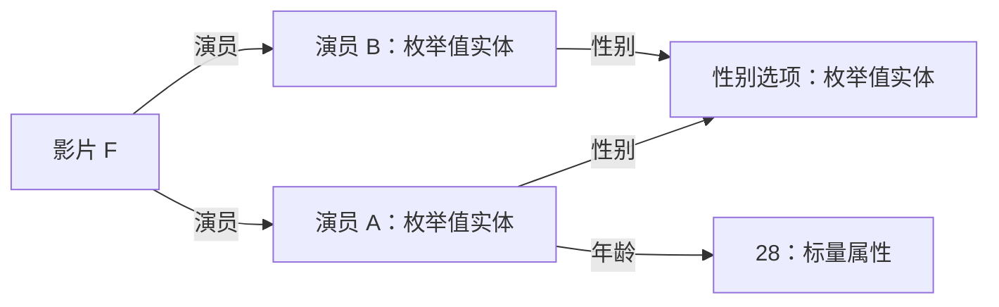

> 历史设计记录：当前实现仅支持 v3 契约，不再包含旧数据兼容或迁移。以 [当前架构审查](CURRENT-CONTRACT-REVIEW.md) 和 `resources/tagging/` 为准。

# 可枚举标签值与标注对象：设计复审

日期：2026-11-02。本文保留改造前的审查依据及目标设计。**运行时已升级为 v2 值实体模型**；具体实现、迁移规则、验收及尚未提供的能力以 [v2 实施与迁移记录](TAG-VALUE-MIGRATION-V2.md) 和 `resources/tagging/` 当前公共资源为准。下文“现有实现”描述的是改造前的 v1，不代表当前运行时。

## 1. 结论

需要被标注的是**具体的可枚举值**，不是定义这个字段的声明。例如，“演员”是一项字段声明，“演员 A”是该字段的一个可选择实体；“性别”“年龄”是另外两项声明，它们的标注对象应该是演员 A。

**让任意标签声明成为业务标注对象，不是本产品必须的抽象，应退出正常业务模型。** 声明的名称、描述、输入组件、启用状态、布局和权限属于配置元数据，继续通过配置编辑器维护即可。以后若需要配置负责人、审核状态等治理信息，可以明确扩展配置元数据，不必让“演员字段有年龄”成为合法的普通标注。

应保留并复用通用标注引擎、历史记录、来源、版本检查、有效交集、撤销和批量任务。需要拆开的是对象身份与关系语义，不是为演员另建一套特例系统。

## 2. 现有实现的问题

本次审查覆盖声明编译、选项创建、标注写入与读取、查询、批量任务、交换格式及管理界面。以下为静态代码审查结果；本次没有向用户资料库写入反例数据。

| 优先级 | 发现与代码依据 | 对需求的影响 |
| --- | --- | --- |
| P1 | `TagsPage.tsx` 对每份已发布声明都显示“给这个标签添加标注”；`SubjectTags.tsx` 将当前声明 key 直接作为 `subject: {kind: "tag", id}`。`Annotations.cs / ValidateScope` 仅要求这个声明存在且启用。 | 字段、分组、具体选项都能成为同一种标注对象。给“演员”字段赋年龄和给演员 A 赋年龄无法从类型上区分，界面也没有引导用户选择具体值。 |
| P1 | `TagAutomation.cs / CreateOption` 在共享选项模式下创建一份 `toggle@1`、布尔值、可标注影片及 tag 的完整声明；内联枚举则只增加 `options.items`，创建时直接以名称作为 ID。 | 具体选项混进字段配置列表，出现没有业务意义的开关。两种枚举的身份、改名、标注能力不一致。新增一个选项还会发布声明世代并重建投影。 |
| P1 | `DefinitionCompiler.cs / Compile` 只检查声明 `parents` 的环；`Annotations.cs / Write` 没有对标注中的引用执行图防环。 | 现有声明 DAG 不能证明“可枚举值之间的标注关系”是 DAG。即使界面画出了层级，也不是用户所要求的关系图。 |
| P1 | `TagQuery.cs / Compile` 的谓词固定读取影片自身的有效标注；`TagJobs.cs / PreviewBulkAsync` 固定将对象解析为影片。 | 当前不能直接表达“筛选具有某种演员属性的影片”，也不能用现有批量任务给一组演员值标注属性。 |
| P1 | `TagEngine.cs / Project` 仅额外校验非整部影片的 scope；`CompiledDefinitions.Project` 校验的是被应用的字段，而没有校验 `subject.kind=tag` 的主体仍存在且启用。 | 主体声明停用或移除后，主体上的旧标注缺少统一的失效边界，可能继续进入有效投影。新值实体模型必须同时校验关系两端。 |

一个需要保留的事实：**当前并非完全不能给具体演员标注**。经共享选项创建的演员已经被编码成独立声明，选中那个声明后可以写标注。问题在于它同时被当作字段，且没有完整的值管理、关联查询及关系防环能力。因此，单把 `tag` 改名为 `value`，或者仅隐藏管理页入口，都不能完成修正。

代码入口：

- [声明管理页](../src/Vroom.Client/src/pages/TagsPage.tsx)、[现有主体标注表单](../src/Vroom.Client/src/tagging/SubjectTags.tsx)
- [选项创建](../src/Vroom.Core/Tagging/TagAutomation.cs)、[声明编译与交集](../src/Vroom.Core/Tagging/DefinitionCompiler.cs)
- [标注写入](../src/Vroom.Core/Tagging/Annotations.cs)、[投影](../src/Vroom.Core/Tagging/TagEngine.cs)
- [查询](../src/Vroom.Core/Tagging/TagQuery.cs)、[批量任务](../src/Vroom.Core/Tagging/TagJobs.cs)
- [当前标注协议](../resources/tagging/annotations.schema.json)、[当前声明协议](../resources/tagging/tag-definition.schema.json)

## 3. 修正后的对象边界

| 对象 | 职责 | 示例 |
| --- | --- | --- |
| 标签声明（Definition） | 定义值类型、单/多值、输入与显示、适用对象、初始化、补全、查询等规则 | 演员、性别、年龄 |
| 值集合（Vocabulary） | 声明一组可复用的枚举值及创建、引用和管理规则；多个字段可引用同一集合 | 演员集合、性别选项集合 |
| 枚举值实体（Term） | 稳定 ID、多语言名称、别名、所属集合、启用状态及独立修订；可以成为标注主体 | 演员 A、演员 B、某个性别选项 |
| 标注（Annotation） | 某个主体在某个字段上的值，附带范围、来源、版本和历史 | 影片 F 的演员是 A；演员 A 的年龄是 28 |

“一切皆为标签”指业务属性统一由声明和标注描述，不意味着每个配置对象、每个数字都要变成一份标签声明。

目标示意（名称只用于解释，产品实现不得按这些名称或 key 分支）：

演员 A 的属性只保存一份；引用演员 A 的影片都通过引用读取它。演员 B 不继承 A 的年龄。“28”是这条属性的值，展示时可以画成叶节点，但不自动创建一个全局的“28”实体。

具体约束：

- 新标注主体明确区分 `film` 与 `term`，不再用 `tag` 同时表示字段和选项；目标命名需随下一版公共协议一起确定。
- 枚举值 ID 与显示名无关。改名、切换语言不会改变引用，同名实体不能自动合并。固定枚举和可新增枚举都使用可寻址的值身份；历史内联 ID 可通过“集合 ID + 原选项 ID”无损映射。
- 适用范围由声明配置：例如仅适用于某些值集合，而不是所有 `term`。宿主通用校验集合成员资格，不感知“演员”或“性别”。
- 枚举值不是字段，因此不需要被强行赋予布尔类型、开关组件或影片时间范围。值实体的资料页依然由适用于该实体的字段和布局动态搭建。
- 影片可以有整部、时间点、区间标注；值实体上的普通属性使用整体范围。年龄可直接标注；若采用出生日期计算年龄，计算规则和时间基准也由声明表达，不写死在产品代码里。

## 4. DAG 必须检查正确的边

区分两张图：

1. **声明组织图**：组织配置项，沿用原有声明父子关系时仍要求无环，但它不能代替实体之间的业务关系。
2. **值关系图**：节点是可枚举值实体；当一个实体的某个标签值引用另一个实体时，形成带字段类型的有向边，例如“演员 A → 性别选项”。同一节点允许被多个节点引用，这才是需要可视化和管理的 DAG。

字符串、数字、日期等是节点属性，不进入共享实体的防环图。影片到值实体的引用是关系入口；声明的配置引用、UI 树及表达式依赖也不混入值关系图。图形可按字段分组、显示多父节点和入边/出边，不能只画配置 JSON 的嵌套树。

新增关系、改值、导入、批量修改、恢复和重新启用都要检查**提交后的有效图**。拒绝自环及跨字段、跨批次形成的环；校验与写入在同一个串行事务中完成，避免并发的 A→B 与 B→A 分别通过。配置变更后重新生效的边同样必须接受检查，不能绕过它。

已有无效关系保留原始历史，在诊断中说明，正常查询与图展示只读取有效关系。若旧数据含环，迁移预览必须指出闭环路径及待处理关系，不能静默删边或依赖遍历顺序随机保留。

## 5. 查询、界面与 Agent

查询需要增加沿值引用查属性的能力。例如“至少一位演员同时满足性别条件和年龄条件”，应是**同一个被引用实体**满足两个谓词，不能拿演员 A 的性别与演员 B 的年龄拼出匹配。声明决定可遍历关系和可用谓词；查询只关联有效投影，并设置深度、结果数和执行预算。

UI 应明确区分两个工作区：

- **标签配置**：编辑字段的名称、规则、组件、布局及选项来源。此处移除对字段声明的普通“添加标注”入口。
- **标签值管理**：从可枚举字段的“管理选项”进入；列表选择一个具体值，右侧显示该值的资料、标注、引用它的影片和关系图。从影片中的已选值也能直接进入同一详情。

表单必须显示实际主体，例如“正在编辑：演员 A”，不能仅显示“演员”。具体值的输入、展示、分类入口和资料布局仍来自 schema，不引入业务页面特例。

Agent 应通过通用能力查询/创建/合并值实体、读写实体标注及预览关系变化。批量任务支持冻结明确的 `film` 或 `term` ID 与修订。用户说“给这些演员补充年龄”时，操作具体实体；不得改成给演员字段写年龄，更不能把同一个值批量填给所有演员。公共 schema、知识、Monaco、UI 和宿主校验必须在同一版本发布。

## 6. 迁移与交换文件

继续保留“标签定义 / 标注数据 / 合并包”的用户概念。建议定义包保存字段、值集合及内置固定选项声明；标注数据包保存用户新增值实体的身份、多语言名称、集合归属和影片/实体标注。单独导出标注时携带所引用的用户值实体及依赖身份；缺少声明的导入先保留为待解析数据，不能按名称猜测绑定。固定选项使用稳定声明身份，用户改名或补充属性走用户层，系统升级不覆盖用户内容。

值实体维护独立修订，不再因每次新增具体选项而重新发布整套字段声明。定义包与值目录可以独立更新，但每次写入仍校验声明世代、值目录引用和目标标注修订。

迁移步骤：

1. 建立旧声明角色与引用清单：字段、分组、共享选项、混合角色。结合选项来源、实际引用和旧配置判断，不按中文名称或“布尔组件”猜测。
2. 为原共享选项建立稳定值身份映射，转换影片的旧 `{tag: key}` 引用。确有混合角色的对象拆成“字段声明 + 值实体”两个身份，保留映射与原始档案。
3. 原标注主体确认为具体选项的，转到相应值实体；曾写在字段声明上的标注进入待处理区。**不能把写在“演员字段”上的年龄分发给所有演员。** 用户可在迁移预览中指定实际对象或保留历史。
4. 内联枚举一并建立可寻址身份；名称重复、缺失依赖、闭环等歧义进入诊断，不静默合并或删除。
5. 在临时投影中验证类型、集合成员、主体/引用两端、DAG、查询及计数，展示变化后再通过可恢复任务切换版本。旧账本及迁移映射保留，支持故障恢复。

## 7. 后续实施验收边界

- 不同演员值的属性互不串写；同一值被多个影片引用时不复制属性。对字段声明写业务标注被明确拒绝。
- 固定及可新增枚举均可管理属性；改名、多语言、同名不同 ID、跨集合复用保持身份稳定。
- 新增选项不生成多余布尔字段；无标签业务 key 分支；陌生值集合与字段可以完整使用 UI 与 Agent。
- 自环、跨字段环、单次批量内的环、并发闭环、导入和重新启用导致的环均被拦截。
- 主体或被引用实体停用后，相关无效记录退出正常读取；恢复时重新验证，原始历史始终保留。
- 关联筛选保证多个条件作用于同一实体；实体批量任务冻结对象与修订，支持暂停、取消及冲突报告。
- 旧数据全部有映射或明确的待处理原因，不自动猜测错误主体；两个独立包与合并包都能完整往返。

本次后续实施已拆开字段、集合和值实体，移除对字段声明的业务标注入口，并提供 v1 迁移。以实施记录为准；本审查中的目标方案不应自动视为全部交付能力。
